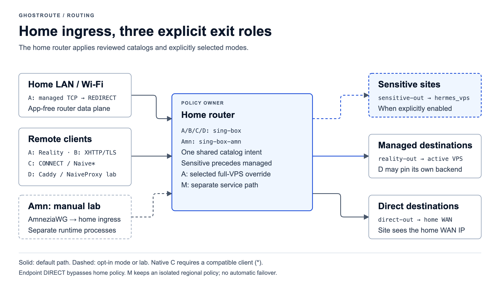

# GhostRoute Channels A / B / C / D / M and Amn

This document is the short handoff view of the current channel model. The
default managed client channels are home-first: their first remote endpoint is
the home public IP/DDNS. Explicit emergency/direct-VPS imports are separate
operator choices. The endpoint can also bypass home through its own DIRECT rules.



[Editable platform diagrams](assets/diagrams/ghostroute-platform-en.html) ·
[Engineering assurance plan](routing-assurance-roadmap.md).

DNS policy is documented separately in [dns-policy.md](dns-policy.md).
The primary DNS goal is no DNS leak to the mobile operator; BrowserLeaks
resolver geography is a secondary fingerprint-consistency signal.

Amn is an opt-in home-first AmneziaWG compatibility lab outside this production
matrix. Its path is client -> home router -> managed policy -> VPS or home WAN.
It has a separate manual start/stop playbook and no boot autostart. See the
[compatibility research and isolation design](../modules/routing-core/docs/channel-amn-research.md).
Its eight named client slots are **Channel Amn 01–08**, with a separate diagnostic
peer. Slot 01 preserves the tested bootstrap import; the other slots are added
without restarting the running channels.
The Amn diagram set ([English](assets/diagrams/channel-amn-architecture-en.html),
[Русский](assets/diagrams/channel-amn-architecture.html)) shows its traffic path,
runtime ownership and profile registration flow.

The shared routing principles for all channels are documented in
[routing-policy-principles.md](routing-policy-principles.md). In short:
the endpoint selects the first-hop channel, then the router owns the route
decision. The default decision is managed-vs-direct split; Channel A also has an
explicit selected full-VPS override for home Wi-Fi/LAN devices and Home Reality
profiles.

Channel M provides an isolated policy for applications with regional egress requirements. Its application mapping and deployment details belong in private operator configuration.

Full Channel M environment ownership, ports and redeploy invariants are in
[channel-m-environment.md](channel-m-environment.md).

## Protocols and implementations

VLESS is a protocol; Xray and sing-box are implementations. Separate the
client-to-router ingress from the router-to-VPS egress:

| Channel / use | Client -> home router | Router ingress implementation |
|---|---|---|
| A, LAN/Wi-Fi | Ordinary LAN traffic; managed flows enter REDIRECT or the selected TPROXY override | sing-box |
| A, remote Home Reality | VLESS + Reality + Vision | sing-box |
| B, selected client | VLESS + XHTTP + TLS | Xray, then a local SOCKS relay into sing-box |
| C1-Shadowrocket, proven compatibility path | HTTPS CONNECT + TLS | sing-box HTTP inbound with TLS |
| C1-sing-box, native design | Naive over TLS; requires a compatible client | sing-box Naive inbound |
| D, optional lab | NaiveProxy-style client over HTTPS | Caddy forward_proxy@naive, then sing-box SOCKS |
| Amn, optional manual lab | AmneziaWG | Isolated userspace engine, then separate sing-box-amn TUN |
| M, service exception | Service uses a router-initiated reverse SSH path | Router loopback HTTP CONNECT inbound, then home-WAN direct-out |

After the managed/sensitive route decision, the configured owned VPS egress
uses sing-box's VLESS + Reality + Vision outbound and a VPS Xray Reality
receiver. This shared second leg does not make Channel C's first leg VLESS.
Non-managed traffic follows `direct-out` through the home WAN under normal
split routing. Sensitive sites mode can select its own backend before general
managed rules; it preserves each channel's ingress protocol.

Changing an SSH management bastion or replacing Entware storage does not
change these protocols or require new client imports. Management access is
documented in [router-management-access.md](router-management-access.md).

## Channel A - Production Router Data Plane

Channel A is the primary production path owned by the router.

```text
Home LAN/Wi-Fi device or home Reality endpoint client
  -> home router
  -> ASUS sing-box REDIRECT, TPROXY or Reality inbound
  -> managed split or selected full-VPS override
       managed destinations     -> reality-out -> active managed egress -> internet
       non-managed destinations -> direct-out via home WAN -> internet
       selected full-VPS internet traffic -> reality-out -> active managed egress -> internet
```

What the first network sees:

```text
LAN clients: ordinary home LAN traffic to the router
remote clients: endpoint -> home public IP/DDNS on the home Reality port
```

DNS proof target:

```text
remote mobile DNS must not use the LTE carrier resolver
```

What target sites see for managed traffic and selected full-VPS internet traffic:

```text
active managed egress exit IP
```

Main role:

- Production router data plane.
- Home LAN devices do not need VPN apps.
- Managed routing is driven by `STEALTH_DOMAINS` and `VPN_STATIC_NETS`.
- Selected full-VPS routing is driven by two explicit sets:
  reserved home Wi-Fi/LAN source IPs and Home Reality `auth_user` profile names.
- Channel A owns router REDIRECT/DNS/catalog behavior.
- Its first `FORWARD` guard blocks direct LAN/Wi-Fi IPv4 egress for already
  classified managed destinations when TCP REDIRECT is missing; managed
  UDP/443 is blocked during refresh. The
  [architecture diagram](architecture.md#layer-2--home-router) shows the failure
  path and the separate channel owners.
- The `active managed egress` behind `reality-out` is operator-selectable between
  the primary owned VPS, a Vault-backed backup Reality provider and an owned
  Hermes clone VPS. See
  [managed-egress-failover-roadmap.md](managed-egress-failover-roadmap.md) and
  `./modules/routing-core/bin/managed-egress-mode` for how the backend is selected;
  the route contract and client profiles do not change.

Selected full-VPS is not a separate channel:

```text
Home Wi-Fi/LAN full-VPS set
  reserved source IP -> TPROXY -> channel-a-selected-lan-full-vps-in
  -> local/private direct
  -> other internet traffic -> reality-out

Home Reality full-VPS set
  reality-in auth_user -> local/private direct
  -> other internet traffic -> reality-out
```

Non-selected home devices and non-selected Home Reality profiles keep the normal
managed-domain split.

Isolation rule:

- Channel B and Channel C must not mutate Channel A REDIRECT ownership, DNS
  ownership, TUN state or automatic recovery behavior.

## Channel B - Production Selected-Client Lane

Channel B is production for selected device-client profiles. It gives those
clients a different first-hop protocol while reusing the same managed split and
managed egress upstream as Channel A.

```text
iPhone / selected endpoint
  -> VLESS + XHTTP + TLS
  -> home public IP/DDNS :<home-channel-b-port>
  -> router local Xray ingress `channel-b-home-in`
  -> local sing-box SOCKS inbound `channel-b-relay-socks`
  -> managed split
       managed destinations     -> reality-out -> active managed egress -> internet
       non-managed destinations -> direct-out via home WAN -> internet
```

What the mobile operator sees:

```text
endpoint -> home public IP/DDNS
TLS / HTTP-like XHTTP traffic
```

It does not see the VPS as the first hop.

DNS proof target:

```text
selected-client DNS follows the active Channel B tunnel, not LTE carrier DNS
```

Main role:

- Production selected-client profile lane.
- Protocol-diverse home-first path compared with Channel A.
- Isolated from Channel A router data-plane ownership.
- Deployed/refreshed by `ansible/playbooks/21-channel-b-router.yml`.

Generated artifacts:

```text
ansible/out/clients-channel-b/
```

The current home-first URI generator includes `allowInsecure=1`. Production use
for selected clients is a routing status, not a claim that TLS peer authentication
is complete. See [the profile authentication boundary](../modules/client-profile-factory/docs/client-profiles.md#server-authentication-and-existing-imports)
and [RA-02](routing-assurance-roadmap.md#ra-02--аутентификация-сервера-channel-b).
Changing this requires a compatible client migration, not a silent profile refresh.

### Channel C/D TLS prerequisite

Before deploying or refreshing either Channel C or Channel D, the selected
router TLS source must contain a current certificate for each enabled public
listener hostname. Production uses the ASUS ACME source
(`channel_c_home_tls_source: asus_acme`); Channel D inherits it unless its own
source is configured. The playbooks reject expired source material and verify
the certificate actually served by the local C1-Shadowrocket and Channel D
listeners, so a stale in-memory process is detected as well.

The router supervisor runs a daily renewal check and a periodic TLS sync. They
are maintenance of C/D listeners only: the ACME HTTP-01 WAN exception exists
only during a near-expiry renewal and is removed on success or failure. This
does not alter Channel A, B or M ownership, routing, DNS, or egress selection.

## Channel C - Home-First Experimental / Compatibility Lane

Channel C is split into two explicitly different variants.

### C1-Shadowrocket / 1-SR

C1-Shadowrocket is the live-proven iPhone compatibility lane.

```text
iPhone Shadowrocket
  -> HTTPS CONNECT over TLS
  -> home public IP/DDNS :<channel-c-shadowrocket-public-port>
  -> router sing-box HTTP inbound `channel-c-shadowrocket-http-in` :<channel-c-shadowrocket-ingress-port>
  -> managed split
       managed destinations     -> reality-out -> active managed egress -> internet
       non-managed destinations -> direct-out via home WAN -> internet
```

What the mobile operator sees:

```text
iPhone -> home public IP/DDNS
TLS / HTTPS CONNECT traffic
```

C1-Shadowrocket is not native Naive. It is the compatibility path that actually
worked on the real iPhone through Shadowrocket.

DNS proof target:

```text
Shadowrocket DNS follows the active proxy/profile, not LTE carrier DNS
```

Generated artifacts:

```text
ansible/out/clients-channel-c/1-SR/
```

Working artifact shape:

```text
iphone-N-c1-shadowrocket-https.png
iphone-N-c1-shadowrocket-https.txt
```

### C1-sing-box / Native Naive

C1-sing-box is the intended stealth-primary Channel C design, but it is
currently client-blocked on the tested iPhone SFI app.

Target shape:

```text
iPhone SFI / sing-box client with outbound type `naive`
  -> Naive over public TLS :443
  -> home public IP/DDNS
  -> router sing-box naive inbound `channel-c-naive-in` :<home-channel-c-ingress-port>
  -> managed split
       managed destinations     -> reality-out -> active managed egress -> internet
       non-managed destinations -> direct-out via home WAN -> internet
```

Router-side status:

- Deployed as a native sing-box `naive` inbound with a real public TLS
  certificate and per-client username/password.
- Server-ready.

iPhone client status from 2026-04-28:

- SFI imported the JSON profile.
- The JSON contained the correct native shape: outbound `"type": "naive"`.
- The tested SFI app used sing-box `1.11.4`.
- It failed before traffic with `unknown outbound type: naive`.
- Official sing-box docs mark Naive outbound as `Since sing-box 1.13.0`.

Current production interpretation:

- C1-sing-box is not iPhone-proven with SFI `1.11.4`.
- SFI native profile generation is disabled by default with
  `channel_c_sfi_native_profiles_enabled: false`.
- Re-test only with an iOS sing-box/SFI build that supports outbound
  `"type": "naive"`.

## Channel D - Router-Native NaiveProxy Lab

Channel D is a router-native NaiveProxy selected-client home-first lane for
Karing / NaiveProxy-style clients. It remains separately owned from Channel C:
successful Channel D Karing/LTE traffic proves Channel D only, not Channel C
native Naive.

```text
Karing / NaiveProxy-style client
  -> home public IP/DDNS :<channel-d-public-port>
  -> router Caddy forward_proxy@naive
  -> local sing-box SOCKS inbound `channel-d-naiveproxy-socks-in`
  -> managed split
       managed destinations     -> reality-out -> active managed egress -> internet
       non-managed destinations -> direct-out via home WAN -> internet
```

Current production interpretation:

- The router-side Caddy-to-sing-box chain is independently verifiable, but a
  successful Karing/LTE client test is still required before treating this
  experimental lane as available. It remains isolated from Channel A/B/C
  ownership.
- The server side is Caddy `forward_proxy@naive` built with a pinned
  `klzgrad/forwardproxy` ref; the current client fingerprint is still Karing,
  not the official Chromium NaiveProxy client.
- A neutral cover site handles ordinary unauthenticated HTTPS GET probes, while
  unauthenticated CONNECT must not become an open proxy.
- Channel D has separate credentials, Karing artifacts and deploy playbook.
- Proof logs must show `channel-d-naiveproxy-socks-in -> reality-out` for
  managed destinations and `direct-out` for non-managed destinations. When
  Channel D is pinned to its own backend (`channel_d_managed_egress_mode` other
  than `follow`), the managed proof tag is `reality-out-d` instead. See
  [managed-egress-failover-roadmap.md](managed-egress-failover-roadmap.md) and
  `managed-egress-mode --channel d`.
- It does not prove Channel C native Naive; Channel C proof still lands in
  `channel-c-naive-in`.

## Channel M — Regional Service Policy

Channel M provides an isolated policy for applications with regional egress requirements. Its application mapping and deployment details belong in private operator configuration.

## No Automatic Failover

No channel automatically fails over to another channel.

```text
Channel A != automatic fallback to B or C
Channel B != automatic fallback for A
Channel C != automatic fallback for A/B
Channel M != automatic fallback for A/B/C
WireGuard = cold manual fallback only
```

Each channel is explicit, selected and independently verified.

RU mobile whitelist mode is not an exception to this rule. It takes the mobile
legs of A, B, C, D and the emergency profile down at the same time, from one
shared cause, so no channel can serve as a fallback for another. See
[whitelist-mode.md](whitelist-mode.md) and
[adr/0011-whitelist-mode-posture.md](adr/0011-whitelist-mode-posture.md).
