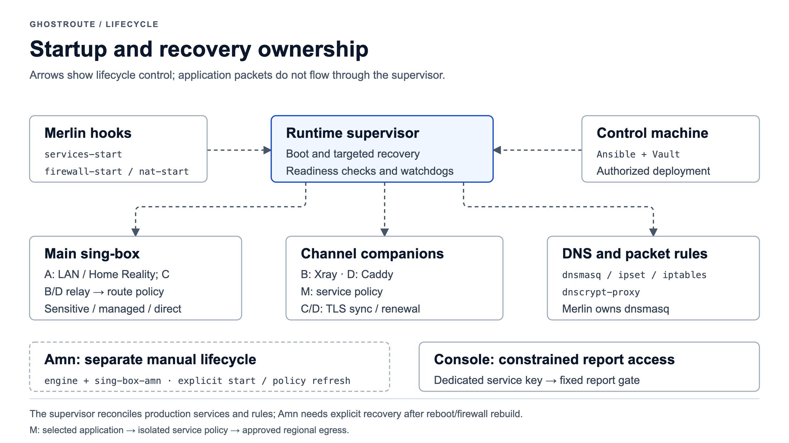
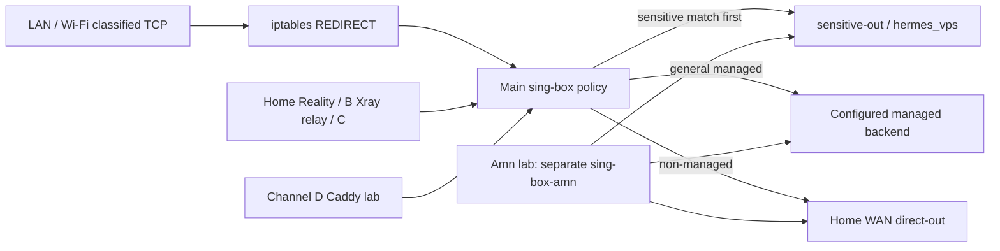
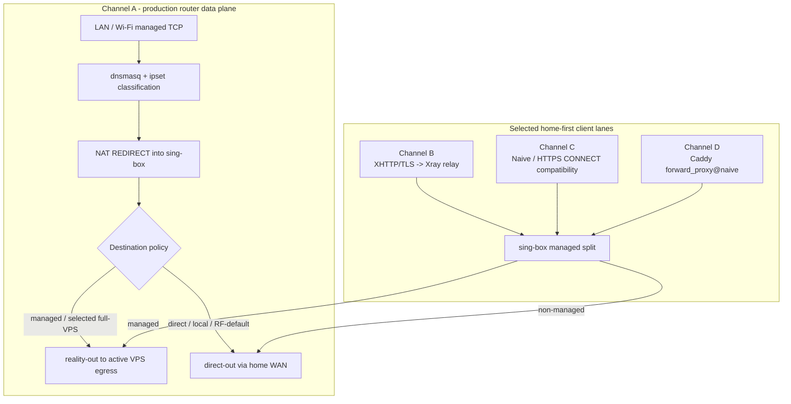
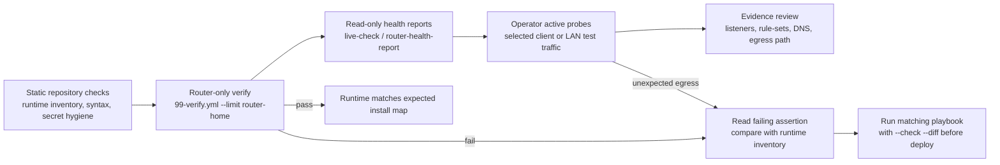
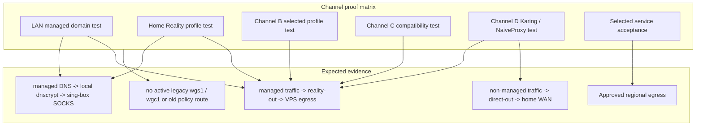

# Router Runtime Map

This document is the operator-facing map of what GhostRoute installs and
manages on the ASUS Merlin router for the current setups. It is a sanitized
expected-runtime view, not a live snapshot: real hosts, numeric ports, client
credentials and deployment-specific values stay in Vault, gitignored
`secrets/`, generated artifacts or health reports.

For the machine-readable source of truth, see
[`configs/runtime-inventory.yml`](../configs/runtime-inventory.yml). For live
verification, run `./verify.sh --verbose` or
`cd ansible && ansible-playbook playbooks/99-verify.yml`.

This map covers the router side. The companion VPS-side runtime map for
Channel M, GhostRoute Console and routing/app surfaces lives in
[`praefectus-ai/docs/vps-runtime-map.md`](https://github.com/eiler2005/praefectus-ai/blob/main/docs/vps-runtime-map.md).

## At A Glance



[Editable lifecycle, routing and recovery diagrams](assets/diagrams/ghostroute-platform-en.html)
· [Русские схемы](assets/diagrams/ghostroute-platform-ru.html).

The lifecycle figure shows control relationships. Packets do not pass through
Merlin hooks or the supervisor. Firmware owns dnsmasq; GhostRoute supplies its
policy includes and managed-egress helpers. Packet paths are:



The diagram shows the default split. Selected Channel A full-VPS changes the
general Internet route; sensitive overrides and private/control exceptions still
apply. Channel D can pin its general managed backend. Managed LAN UDP/443 is
dropped for TCP fallback; an already classified managed IPv4 TCP/UDP443 guard
covers the documented REDIRECT failure case. See [privacy assurance](privacy-assurance.md)
for the exact scope and [the engineering register](routing-assurance-roadmap.md)
for remaining acceptance work.

Channel M has a separate service data path. The router establishes the outbound
SSH remote-forward; the application then sends requests in the reverse direction:


Managed DNS is another distinct path: dnsmasq sends managed queries to
dnscrypt-proxy, which uses a sing-box SOCKS inbound and the managed egress.
Default/direct DNS follows the default resolver policy. Neither DNS nor M is
an ingress relay for Channel B. Amn remains outside production supervisors and
requires explicit manual recovery after reboot or firewall rebuild.

## Storage ownership and operating modes

The **main operating mode** uses a healthy writable ext4 USB volume for Entware.
Internal JFFS stores boot hooks and router-owned configuration; RAM holds running
processes and the live network state. The **temporary read-only recovery mode**
keeps reading Entware binaries from USB while selected writable paths are bound
to RAM and restored from a small private JFFS archive after reboot.

| Storage / path | Main mode | Temporary read-only recovery mode | Survives reboot |
|---|---|---|---|
| Firmware image: `/bin`, `/sbin`, `/usr` | Merlin system tools and built-in services | Same firmware tools bootstrap recovery | Yes; managed by firmware updates |
| NVRAM | Firmware settings such as WAN, Wi-Fi, SSH and custom-script enablement | Same firmware settings | Yes |
| Internal writable flash: `/jffs/scripts`, `/jffs/configs`, `/jffs/keys` | Boot hooks, supervisor/watchdogs, dnsmasq includes and router-owned keys | Same, plus the opt-in recovery helper and private seed under `/jffs/ghostroute-recovery` | Yes |
| USB ext4: `/opt/bin`, `/opt/sbin`, `/opt/lib` | Entware programs and libraries; package installation and upgrades write to USB | Existing programs and libraries are still read from USB; package writes remain unavailable | Yes, while the USB remains readable |
| `/opt/etc` | Configurations, service init scripts, TLS material and rule-sets stored on writable USB | RAM bind mount restored from the private JFFS seed | USB files persist; temporary changes require a refreshed seed |
| `/opt/var/run`, `/opt/var/log`, `/opt/var/cache/dnscrypt-proxy`, `/opt/tmp` | Entware service directories on writable USB in the normal layout | RAM bind mounts; resolver cache is seeded, PID/log/tmp directories start empty | RAM content does not persist |
| `/tmp`, running processes, live iptables/ipset/conntrack state | Volatile runtime, reconstructed by firmware and GhostRoute startup | Volatile runtime, reconstructed after RAM directory preparation | No |
| Control-machine private backup under ignored `reports/router-backups/` | Recovery copy outside the router | Recovery copy for replacing the USB and restoring current config | Yes on the control machine; not an offsite copy |

`/opt` is a link to the Entware directory on the USB volume, normally through
`/tmp/opt`. A USB mountpoint can be under `/tmp/mnt/<volume>` while its files
still live on USB; the path prefix alone does not identify the storage medium.
In temporary mode the same `/opt/etc` path instead resolves to a RAM bind mount.

Normal startup mounts writable USB, establishes the Entware link and starts
`rc.unslung`; the runtime supervisor reconciles DNS, listeners, routing and cron.
Temporary recovery first identifies the configured USB UUID, mounts readable
write-protected ext4 with `ro,noload` if firmware could not mount it, restores
the selected RAM directories, and then hands startup to the same service owners.
It does not change sensitive-site or general managed-egress policy.

The temporary mode is a bridge until writable storage is restored. It does not
make the whole installation resident in internal flash or RAM: unreadable USB
binaries still prevent recovery. Manual config/certificate changes need a seed
refresh; successful opted-in Ansible router deployments refresh it automatically.
After USB replacement, verify normal writable mounts, restore current config,
disable emergency recovery and verify a controlled reboot.

See the [temporary-mode runbook](../modules/recovery-verification/docs/readonly-entware-boot-recovery.md)
for installation, private snapshots, limits and replacement steps. Sensitive
sites mode is a separate routing policy and can operate in either storage mode.

## Router-Owned Runtime Objects

| Area | Runtime objects | Installed or rendered by | Verification signal |
|---|---|---|---|
| Merlin boot hooks | `/jffs/scripts/nat-start`, `/jffs/scripts/firewall-start`, `/jffs/scripts/services-start`, `/jffs/scripts/ghostroute-runtime-supervisor.sh` | `deploy.sh`, routing Ansible roles | `99-verify.yml` checks firewall/NAT rules, supervisor bootstrap and listener ownership |
| Routing core | `/opt/bin/sing-box`, `/opt/etc/sing-box/config.json`, `/opt/etc/init.d/S99sing-box`, `/opt/etc/sing-box/rule-sets/` | `20-stealth-router.yml`, `singbox_client`, routing-core scripts | REDIRECT listener, Home Reality listener, rule-set mirror, direct/reality routing |
| Catalog DNS | `/jffs/configs/dnsmasq-stealth.conf.add`, `/jffs/configs/dnsmasq-vps-managed.conf.add`, optional selected full-VPS include | `stealth_routing`, DNS catalog inputs | managed domains resolve into `STEALTH_DOMAINS`; direct/RU domains stay out of managed DNS |
| Managed DNS egress | `/opt/sbin/dnscrypt-proxy`, `/opt/etc/dnscrypt-proxy.toml`, `/opt/etc/init.d/S09dnscrypt-proxy2` | `dnscrypt_proxy` | local dnscrypt listener plus sing-box SOCKS listener for dnscrypt |
| Channel B home relay | `/opt/bin/xray`, `/opt/etc/xray/channel-b-home-relay.json`, `/opt/etc/init.d/S99xray-channel-b-home` | `21-channel-b-router.yml`, `channel_b_home_relay` | Channel B listener, firewall allow, connlimit and MSS clamp |
| Channel C native and compatibility lanes | sing-box inbounds and TLS assets under `/opt/etc/sing-box/` | `22-channel-c-router.yml`, `singbox_client` | native Naive and Shadowrocket compatibility listeners plus firewall redirect/allow checks |
| Channel D NaiveProxy lab | `/opt/bin/caddy-channel-d-naiveproxy`, `/opt/etc/caddy/channel-d-naiveproxy/Caddyfile`, `/opt/etc/init.d/S99caddy-channel-d-naiveproxy`, `/opt/share/channel-d-naiveproxy/` | `24-channel-d-router.yml`, `channel_d_naiveproxy` | Caddy listener, config markers, SOCKS upstream, cover-site proof and firewall checks |
| Channel Amn compatibility lab | `/opt/etc/ghostroute-amn/` persistent engines/settings/policy; `/tmp/ghostroute-amn/` volatile state; separate AmneziaWG and `sing-box-amn` | `28-channel-amn-lab.yml`, Routing Core controller | Explicit status, diagnostic peer and client tests; manual start/stop and additive `sync-peers`, outside production recovery |
| Channel M reverse lane | `/jffs/keys/channel-m-reverse-key`, `/jffs/scripts/channel-m-reverse-tunnel.sh`, supervisor-owned cron, supervisor `channel-m-recover`/`channel-m-status` | `23-channel-m-reverse.yml`, runtime supervisor | local router ingress, `ChannelMReverse` cron, on-demand Channel M control and VPS reverse listener validation |
| Recovery supervisor/watchdogs | `/jffs/scripts/ghostroute-runtime-supervisor.sh`, `/jffs/scripts/singbox-watchdog.sh`, `/jffs/scripts/dnscrypt-watchdog.sh`, Channel M reverse watchdog cron | `stealth_routing`, `singbox_client`, `dnscrypt_proxy`, `23-channel-m-reverse.yml` | `services-start` single-owner bootstrap, delayed LAN REDIRECT / UDP/443 DROP stabilization, minute-level listener probes, Channel M on-demand recovery and targeted restarts or stale tunnel replacement |
| Health monitor | `/jffs/scripts/health-monitor/run-probes`, `aggregate`, `daily-digest`, `lib.sh` | `health_monitor` | hourly probes, aggregate state and daily digest cron jobs |
| Console router SSH boundary | `/jffs/addons/ghostroute-console-readonly/` gate/policy, live authorized keys and persistent `sshd_authkeys` | staged `29-console-router-access.yml` | dedicated service key accepts reports and rejects shell/uploads/forwarding; operator key is separate |
| Cold fallback | preserved `wgc1_*` NVRAM and `/jffs/scripts/emergency-enable-wgc1.sh` | recovery tooling | WireGuard disabled in steady state; emergency script is manual only |

## Installed Software Versions

Last read-only router snapshot: 2026-06-13, collected through Ansible raw
commands with the same inventory and Vault vars used by `99-verify.yml`.
This table intentionally records only software identity and version data; it
does not include endpoints, listener numbers, credentials or traffic evidence.

| Component | Router-observed version | Source |
|---|---|---|
| Router model | `RT-AX88U_PRO` | `nvram get productid` |
| Asuswrt-Merlin firmware | train `3_0_0_6`, build `102.7`, extend `2` | `nvram get firmver/buildno/extendno`; dots replaced with underscores to avoid IPv4 scanner false positives |
| Linux kernel | `4.19.183` | `uname -r` |
| BusyBox | `1.25.1` | `busybox` banner |
| Entware `opkg` | `80503d94e356476250adaf1f669ee955ec26de76` (`2025-11-05`) | `opkg --version` |
| `sing-box` | Entware package `sing-box-go 1.13.3-2`; init script rejects zombie pids before reporting running or blocking startup | `opkg list-installed`; `/opt/etc/init.d/S99sing-box status`; listener checks |
| `dnscrypt-proxy` | Entware package `dnscrypt-proxy2 2.1.15-1`; init/boot guard sets `vm.overcommit_memory=1` for Go runtime startup | `opkg list-installed`; `cat /proc/sys/vm/overcommit_memory` |
| Xray | Entware package `xray-core 26.2.6-1` | `opkg list-installed` |
| Channel D Caddy | custom repo-built binary, installed at `/opt/bin/caddy-channel-d-naiveproxy` | local binary managed by `24-channel-d-router.yml`; verify module support via `99-verify.yml` |
| dnsmasq | `2.93-test2` | `dnsmasq --version` |
| iptables | `1.4.15` | `iptables --version` |
| ipset | `7.6`; router prints kernel/userspace protocol warning `6-6` vs `6-7` | `ipset --version` |
| Dropbear SSH | `2025.89` | `dropbear -V` |
| OpenSSL | `3.5.5` | `/opt/bin/openssl version` / `openssl-util 3.5.5-1` |
| Python | `3.13.9` / Entware package `python3 3.13.9-2` | `/opt/bin/python3 --version`, `opkg list-installed` |
| Bash | `5.3.9` / Entware package `bash 5.3-2` | `/opt/bin/bash --version`, `opkg list-installed` |

Go-based router binaries can be memory-sensitive when invoked only to print
their embedded version string. Prefer `opkg list-installed` for Entware-managed
`sing-box`, `dnscrypt-proxy` and Xray versions, and use `99-verify.yml` for
Channel D Caddy module/config proof instead of repeatedly calling the Caddy
binary directly on the router.

## Channel Data Planes



Channel A is the default production router data plane. Channel B is production
for selected device-client profiles. Channel C keeps the Shadowrocket-proven
compatibility lane and the native Naive design. Channel D is a separate
router-native NaiveProxy lab lane; it must not be treated as Channel C proof.

## Channel M — Regional Service Policy

Channel M supports applications with regional egress requirements through an
isolated service policy.

## Channel Amn Manual Lab

Amn adds a separate home-first UDP ingress:
`iPhone -> AmneziaWG -> sing-box-amn / gVisor TUN -> selected exit`.
Sensitive matches use `sensitive-out -> hermes_vps` without automatic fallback;
other managed matches use the active Reality/Vision backend, and ordinary
destinations use home WAN. It reads the existing policy and DNS services without
taking their ownership. A missing Amn TUN retains a terminal unreachable guard.

Persistent binaries, settings and policy live on writable Entware USB under
`/opt/etc/ghostroute-amn/`; PID, lock, logs and the active ownership snapshot live
in RAM under `/tmp/ghostroute-amn/`. The complete private bundle, eight named
client slots and a separate diagnostic identity stay on the control Mac under
ignored `ansible/out/channel-amn/`, with an encrypted local backup.

The current lab has no boot hook or watchdog. After reboot start it explicitly;
after firewall or shared-policy changes use stop/start. This AWG2 compatibility
proof does not imply AWG 3.1 support or eight-client concurrent throughput.
See the [runbook](../modules/routing-core/docs/channel-amn-research.md) and the
editable diagrams in [English](assets/diagrams/channel-amn-architecture-en.html)
or [Русский](assets/diagrams/channel-amn-architecture.html). Existing overview
images above show the production runtime; these separate figures cover Amn.

## Test Schemes

The test schemes below show how to prove the installed runtime without changing
router state. They complement the command checklist in the next section.





Test interpretation:

- Channel A/LAN and Home Reality tests should prove managed DNS plus managed
  traffic through Reality while direct/default destinations stay direct.
- Channel B/C/D tests prove selected home-first client entry and then the same
  managed split. Channel D proof is D-specific and must not be used as Channel
  C native proof.
- Channel M proof verifies real application requests against the approved
  regional policy; a healthy listener alone is insufficient.
- Legacy `wgs1`/`wgc1` remain a manual cold fallback and should not appear in
  production proof output. The separately enabled Amn interface is a lab object,
  not activation of either legacy lane.

## Ports And Exposure

The tracked docs use symbolic port names. Numeric values are deployment
material and must stay out of shareable documentation.

| Symbolic listener | Owner | Bind scope | Exposure model |
|---|---|---|---|
| `singbox_redirect_port` | `router_sing_box` | router interfaces | LAN transparent REDIRECT |
| `home_reality_ingress` | `router_sing_box` | router WAN / selected ingress | selected remote clients |
| `channel_b_home_ingress_port` | `router_channel_b_xray_relay` | router WAN / selected ingress | selected Channel B clients |
| `channel_c_native_public_port` | `router_sing_box` | router WAN | selected Channel C clients |
| `channel_c_shadowrocket_public_port` | `router_sing_box` | router WAN | selected compatibility clients |
| `channel_d_naiveproxy_public_port` | `router_channel_d_caddy_naiveproxy` | router WAN | selected Channel D clients |
| Amn private `settings.json` field `port` | `router_channel_amn_lab` | router UDP ingress | authenticated selected lab peers; opened only during explicit start |
| Channel M private service settings | service-owned | private policy | authenticated selected services |
| `dnscrypt_port` | `router_dnscrypt_proxy` | router loopback | local managed DNS forwarder |
| `singbox_dnscrypt_socks_port` | `router_sing_box` | router loopback | dnscrypt egress over Reality |

Public firewall exposure must be deliberate, channel-specific and verified by
`99-verify.yml`. Channel M reverse must remain loopback on the router and
Docker-bridge scoped on the VPS side.

## Watchdogs And Recovery Jobs

| Job | Cadence | Purpose |
|---|---:|---|
| `SingBoxWatchdog` | every minute | Probes critical sing-box listeners and restarts only sing-box when they disappear. |
| `DnscryptWatchdog` | every minute | Probes the dnscrypt listener and restarts only dnscrypt-proxy when needed. |
| `ChannelMReverse` | every minute | Validates the reverse SSH tunnel, kills stale sessions and recreates the remote-forward. |
| `RotateSingBoxLog` | hourly | Rotates the sing-box log without changing routing state. |
| `SaveIPSet` | every 6 hours | Persists managed ipset state for router reboot recovery. |
| `DomainAutoAdd` | hourly | Curates auto-discovered domain candidates through the routing-core workflow. |
| `UpdateBlockedList` | daily | Refreshes the controlled blocked-domain list. |
| `HealthMonitorProbes` | hourly | Runs router health probes. |
| `HealthMonitorAggregate` | hourly | Aggregates router health state. |
| `HealthMonitorDaily` | daily | Emits the daily health digest. |

These jobs are recovery and observability guardrails. They must not silently
turn one channel into another, enable WireGuard, change client credentials or
add public listeners.
They do not start or repair Amn; the lab has a separate manual lifecycle.

## Live Verification Checklist

Use read-only checks before and after router changes:

```bash
./verify.sh --verbose
cd ansible
ansible-playbook playbooks/99-verify.yml --limit router-home
./tests/test-runtime-inventory.sh
```

Expected healthy signals:

- `sing-box` REDIRECT, Home Reality, router DNS-forward and dnscrypt SOCKS
  listeners are present.
- `STEALTH_DOMAINS` exists and managed DNS includes route through local
  dnscrypt, while direct/RU domains stay out of the managed include.
- Channel B/C/D checks pass only when the corresponding channel is enabled.
- Channel M reverse checks confirm router cron, local ingress and bridge-scoped
  VPS listener behavior.
- Legacy `wgs1`/`wgc1` interfaces and old policy routes remain absent.
- Amn status is checked separately with `28-channel-amn-lab.yml`; a green
  production verification does not prove that the manual lab is running.

If a live check disagrees with this map, treat the live check as drift evidence:
read the failing assertion, compare with `configs/runtime-inventory.yml`, then
run the matching playbook in `--check --diff` before any deploy.

## Related Docs

- [`architecture.md`](architecture.md) - layered routing model.
- [`channels.md`](channels.md) - channel handoff view.
- [`channel-d.md`](channel-d.md) - Channel D NaiveProxy lab details.
- [`channel-m-environment.md`](channel-m-environment.md) - Channel M reverse egress details.
- [`dns-policy.md`](dns-policy.md) - DNS consistency and leak policy.
- [`runtime-inventory.md`](runtime-inventory.md) - inventory policy and upgrade gates.
- [`praefectus-ai/docs/vps-runtime-map.md`](https://github.com/eiler2005/praefectus-ai/blob/main/docs/vps-runtime-map.md) - companion VPS-side runtime map.
- [`modules/routing-core/README.md`](../modules/routing-core/README.md) - routing-core module ownership.
- [`modules/recovery-verification/docs/failure-modes.md`](../modules/recovery-verification/docs/failure-modes.md) - recovery runbook.
