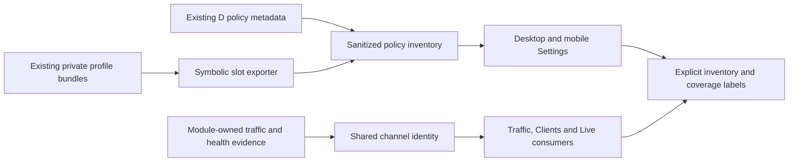

# Console channel observability and performance plan

Status: proposed implementation sequence. This document does not change runtime
state, promote experimental channels, or authorize deployment.

## Implemented visibility slice

Shared channel identity now recognizes D, anyT and Snell across normalization,
evidence selectors and device-role presentation. Explicit ingress evidence takes
priority over legacy hints; unknown policy channels remain unknown. Settings on
desktop/mobile includes symbolic slots, lifecycle and an inventory-only coverage
notice. The local bundle exporter excludes the diagnostic anyT peer and exports
no credentials, endpoints or authentication usernames. Bundle presence does not
establish runtime enablement, so exported slots use `unknown` status.

Performance measurements run independently without the previous suite-wide
warm-up hook. These are initial-load measurements in sequence, with subsequent
navigation measured separately; they are not a guarantee of uniformly cold caches.
Budgets remain unchanged. Failed live runner workspaces retain private traces.

Production-sized evidence exposed a separate request-path issue: normalized-row
snapshot ID lookup loaded full snapshot payloads repeatedly. It now reads metadata
only; Catalog requests only the domains payload. A regression test rejects the
full-payload dependency in identifier lookup. Prepared traffic data and the
accounting contract are unchanged by this repair.

Per-process anyT/Snell traffic collection, per-profile byte accounting and new
authenticated health adapters remain source-module work in step 3 below. This
slice does not claim that existing main-process logs cover isolated processes.

### Rollback for the visibility slice

The deploy playbook preserves the previous image under a timestamped rollback
tag before building. It also creates a private `rollback/<timestamp>/` directory
under the Console root containing the module source archive (including compose
configuration), a consistent SQLite backup, available private inventory/attribution
files and `image-tag`. Existing data is retained; no schema migration is required.

To revert, stop only the Console compose service, restore the module source archive
into its repository, restore the saved private inventory/attribution files, tag
the image recorded in `image-tag` as `ghostroute-console:latest`, and start compose
with `up -d --no-build`. The unchanged database schema supports the previous image.
Restore the database backup only if a data rollback is actually needed, while
Console is stopped; remove the stopped database's WAL/SHM files and restore data
ownership before restart. Verify API health, Settings, traffic detail and public
mobile delivery after rollback. Keep backups private and outside automatic pruning.

The VPS helper `vps/rollback-console.sh <backup-directory>` performs the image,
source and configuration restore and checks local API health. Run it as root on
the Console host. It leaves the current database intact; restoring the consistent
database backup remains a separate explicit operator action. Validate public
delivery after invoking it. The helper never operates router services.

## Outcome and boundaries

Console should identify Channel D, Channel anyT (AnyTLS), and Snell alongside
existing channels in Settings, Clients, Traffic, Live, Health, and mobile views.
An operator should be able to distinguish configured profiles, observed activity,
traffic-accounting coverage, runtime health, and application acceptance.

Keep Console a consumer of module-owned evidence. Preserve issued profiles,
credentials, ingress settings, TLS verification, routing ownership, and recovery.
Do not add channel switches, profile generation, router restarts, or automatic
failover to the GUI. Performance work must not change routing or DNS.

The first release should provide correct identities and honest coverage labels.
Complete byte accounting is a separate milestone where source evidence is absent;
do not delay basic visibility or manufacture totals to fill that gap.

## Current implementation gaps

- [Policy normalization](../app/src/lib/routing-policy-snapshot.mjs) accepts only
  A/B/C and defaults unrecognized channels to A. The
  [snapshot template](../templates/policy-snapshot.local.json.j2) exports only
  A/B/C profiles.
- [Traffic normalization](../app/scripts/lib/normalize.mjs) infers C from generic
  `naive` and `shadowrocket` strings. A client application name cannot establish
  its ingress channel; native Naive must not conflate C and D.
- The [GUI seed](../app/scripts/seed-gui-test-db.mjs) needs representative new
  channel profiles, attribution, traffic, missing-evidence, and lifecycle cases.
- [Performance tests](../app/tests/e2e/performance.spec.ts) perform serial API and
  desktop warm-up in `beforeAll`, suppress individual warm-up errors, and run as
  a serial group. A setup timeout can prevent the entire measurement set from
  running. The mobile cases in the desktop performance project use Chromium with
  an iPhone user agent; actual WebKit coverage is a separate functional gate.
- The [live runner](../vps/performance-live.yml) targets a VPS-local listener and
  removes its temporary workspace on exit. Public delivery needs separate proof,
  and failed-run traces need preservation before cleanup.

These are code-level findings, not a diagnosis of the current live server.
Keep incident measurements and deployment-specific evidence in ignored reports.

## Channel and identity model

Use a small shared channel descriptor module in Console, not a new channel
management framework. Keep existing A/B/C identifiers and public payload fields
compatible. Define aliases once, including `anytls`/`anyT`, and preserve unknown
values as unknown instead of silently converting them to A or C.

| Lane | Display and lifecycle | Evidence requirements |
|---|---|---|
| Home LAN / A | Existing production behavior | Preserve current accounting and selected full-VPS semantics. |
| B / C | Existing selected-client lanes | Preserve distinct identities and existing policy semantics. |
| D | Native NaiveProxy; experimental until separately accepted | Inspect its owned runtime and policy; do not infer C or general egress from the protocol name. |
| anyT | Production AnyTLS; eight protected profile slots | Separate runtime/recovery, policy freshness, authenticated application evidence, and profile compatibility. |
| Snell | Snell with ShadowTLS; experimental until separately accepted | Track both authentication layers, isolated process and manual boot lifecycle; server evidence is not phone acceptance. |
| M | Separate service policy | Keep outside physical client ingress aggregation. |
| Amn / legacy WireGuard | Retained disabled lanes by default | Show configured disabled/retained state without treating it as an outage. |

Use explicit channel/profile metadata first, then exact owned inbound/source tags.
Use legacy heuristics only for supported old evidence and never let them override
explicit metadata. Do not classify by free-text client application names.

Separate physical device identity from channel profile identity. A private
operator mapping may associate old and new profiles with the same device; never
merge by slot number, a rotating report alias, or similar names. Keep observed
aliases auditable, count independent sessions once, and exclude diagnostic probe
identities from user totals. Do not import QR/URI payloads, credentials, private
approval manifests, or raw runtime settings into Console.

Keep these dimensions independent in prepared read models:

- lifecycle: production, experimental, retained;
- configured state: enabled, disabled, unknown;
- observation: healthy, degraded, unavailable, stale, not observed;
- coverage: profile inventory, connection events, byte counters, route split;
- acceptance: authenticated server probe and separately recorded real-client proof.

Expose source and observation time. SSH failure means collection is unavailable;
it does not prove that the channel is down. Retain last-known-good data with a
visible stale label. Missing counters mean unavailable accounting, not zero bytes.

## Delivery sequence

### 1. Establish a trustworthy performance baseline

Reproduce locally against the seeded production build with `npm run test:perf`.
Record setup/warm-up duration separately from measured page/API latency. Keep the
existing page and API budgets; raising them is not a repair.

Make warm-up failures attributable to a named path, with bounded request timeouts
and HTTP status checks. Preserve traces and a structured result even on setup or
SSH failure. Let independent measurements report their own result instead of
silently disappearing behind the first serial failure. Explicitly label cold and
warmed runs. Change server code only after timings identify a bottleneck.

Compare production-build local, VPS-local, and public delivery independently.
Inspect document TTFB, response download, static assets, prepared-model queries,
cache misses, SQLite contention, and collector overlap as evidence warrants.
Treat host SSH reachability as a separate diagnostic track. Do not introduce
operator-key fallback or mask unreachable checks as passed.

Acceptance: each requested check has a pass/fail/not-run result and an attributable
reason; local performance passes without relaxed budgets. Live health and public
delivery remain unverified until their own checks complete.

### 2. Correct channel identity and add inventory visibility

Add the shared descriptors and narrow regression fixtures before changing
normalization. Extend the sanitized policy snapshot and its reader additively;
old snapshots remain readable. Source new profile slots from their existing
private module-owned metadata through an explicit sanitized export. Console must
not require credential-bearing bundles or access to Vault at request time.

Update Settings, client attribution, filter options, badges and route explanations
across desktop/mobile consumers. Keep profiles visible even if traffic has not
been observed. Show lifecycle and coverage alongside status, using the existing
pages rather than introducing a new dashboard.

Acceptance: D is never mislabeled C, anyT/Snell never default to A, unknown stays
unknown, and existing A/B/C fixtures retain their interpretation. A device using
multiple explicitly mapped profiles appears once with its channel history.

### 3. Fill source-evidence gaps in the owning modules

First map each lane's available profile identifiers, process/log sources,
application checks and counters. Extend Traffic Observatory and Health Monitor
only where that map demonstrates a gap. Prefer additive fields in existing
versioned JSON contracts; document any contract change and retain old consumers.

Traffic remains `traffic-facts --json` schema v3 over `traffic-evidence --json`.
Do not add a machine dependency on `traffic-report`. Independent anyT and Snell
processes need their own bounded evidence sources; main sing-box logs alone must
not be assumed to cover them. Scope event cursors and deduplication by source,
including rotation/restart handling, and avoid unbounded log scans.

If per-profile bytes or a direct/managed split cannot be established read-only,
ship the channel with partial coverage. Do not add packet-accounting firewall
rules as an incidental Console change. Preserve
`Total = Via VPS + Direct + Unknown`; transport ingress and downstream relay
observations are not independent user bytes to be summed.

Reuse Health Monitor's anyT semantics without copying its credential-bearing
gate output into Console. An authenticated control-machine check may remain
control-machine-only and explicitly unavailable in the collector. Do not run
application probes on page requests or equate a running process/TCP listener with
application health.

Any change to report scripts behind the Console router gate requires its fixture
tests and a separately authorized allowlist refresh under the
[service-key runbook](../../../docs/console-router-ssh-access.md). Keep collectors
read-only and preserve current polling bounds.

Acceptance: fixtures cover enabled, disabled, stale, unavailable, unknown,
missing counters, source restarts, duplicated relay evidence and probe exclusion.
Old JSON fixtures still load; new traffic does not inflate device or VPS totals.

### 4. Verify and release in reversible slices

Keep performance diagnostics, channel identity/UI, and source adapters as separate
reviewable changes on the feature branch. Do not combine them with dependency
upgrades, routing changes, profile migration, or experimental-channel promotion.

For implementation, run the relevant model/normalization tests and source-module
fixtures, then a local seeded GUI review (`npm run dev:gui`), desktop/Android/
WebKit coverage (`npm run test:e2e:gui`), and `npm run test:perf`. Data-layer changes
also require `verify:timezone`, `verify:aggregates`, and `bench:dashboard` against
the seeded data directory. Seed migrated devices and a realistic volume of events.

Before an explicitly authorized deployment, preserve the current Console image,
configuration and a consistent SQLite backup. Prefer additive schema/read-model
changes; document old-image compatibility before changing schema. Never reset the
production database merely to refresh channel labels. If stored attribution
requires correction, rebuild only affected derived data from retained evidence,
with a dry-run comparison; do not invent missing historical identities.

Deploy Console-only visibility first when old report contracts suffice. Deploy
source adapters and refresh the service allowlist only as a separately reviewed,
authorized slice, followed by collection validation. Existing users should not
need a client refresh for observability work.

After deploy, require live performance plus the public no-port URL in real
WebKit/iPhone coverage: `/` reaches the mobile shell, critical CSS is applied,
`/m/live` has its activity summary, `/traffic` retains inline detail, and
browser-compressed responses stay within the delivery budget. Verify current
anyT policy, both owned processes, persistent recovery, authenticated application
evidence and preservation of all eight imports when shared infrastructure changes.

Rollback a failed slice using the reviewed previous Console image and compatible
data/configuration. Roll back changed report adapters and their allowlist together.
Do not recover Console by disabling a channel, changing issued client imports,
bypassing TLS, or changing sensitive routing fallback.

## Completion criteria

The implementation is complete when channel identity, device attribution, health
freshness and traffic coverage are truthful across desktop and mobile; local and
authorized live gates have recorded results; and rollback is documented and
reviewable. Experimental promotion and richer accounting remain explicit separate
work if their client acceptance or source evidence is still missing.
