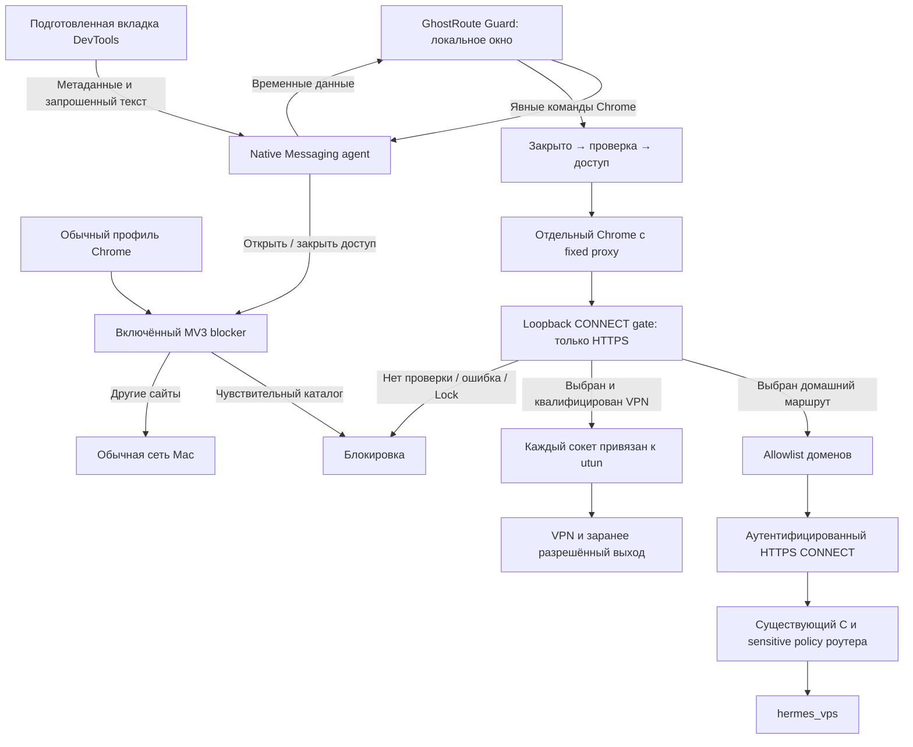

# GhostRoute Guard for Mac

Локальное приложение для управления чувствительными сайтами в **обычном Chrome**.
Главные кнопки: **«Открыть доступ в Chrome» / «Закрыть доступ в Chrome»**.
Расширение снимает или включает блокировку в том же профиле браузера, используя
его текущую сеть и proxy. Отдельный защищённый браузер — дополнительная опция.

Обычный Chrome получает отдельное расширение, блокирующее чувствительный
каталог. Оно действует **только после установки и включения в конкретном
профиле**. Guard не является firewall для всех программ Mac.

## Реализовано

- Нативное приложение SwiftUI с боковой панелью, таблицей событий, системными
  кнопками, выбором файла, поиском и импортом приватного JSON-профиля;
  явный выбор маршрута, проверка выхода, запуск браузера и немедленная блокировка.
- Компактная панель с кнопками «Открыть доступ» / «Закрыть доступ», показателями
  соединений и передачи, поиском, фильтрами и раскрытием причин в живом журнале.
- Собственная иконка, адаптивная панель, отдельные разделы Google Chrome и справки;
  справка также доступна в меню macOS, popup и отдельной странице расширения.
- Журнал последних 300 событий хранится только в памяти. В нём видны домены,
  решения шлюза, длительность и объём передачи; очистка сохраняет счётчики запуска.
  Счётчик блокировок открывает их список; число показанных событий и кнопка
  сброса фильтров объясняют пустую таблицу. Ошибки запуска/связи также видны
  в журнале, а недоступный шлюз можно запустить повторно из окна приложения.
- HTTPS CONNECT с проверкой CA/имени или заранее доверенного SHA-256 сертификата.
  При pin-проверке пароль отправляется только после совпадения сертификата.
- Домашний режим с явным allowlist: неизвестный домен получает отказ. Он может
  использовать уже настроенный C HTTPS CONNECT без изменения существующих
  импортов. Это не реализация native Naive и не изменение статуса C1-sing-box.
- VPN-адаптер, привязывающий каждый DNS/целевой сокет к выбранному `utun` через
  `IP_BOUND_IF` / `IPV6_BOUND_IF`. Выход должен совпадать с заранее разрешённым;
  отсутствие интерфейса и ошибка привязки не вызывают unbound retry.
- Отдельный Chrome profile, fixed proxy без DIRECT, отключённые implicit
  loopback bypass, локальное разрешение целевых имён, QUIC и непроксированный
  WebRTC UDP. Штатная песочница Chrome остаётся включённой.
- MV3 declarativeNetRequest blocker из общего sensitive-каталога: явно блокирует
  открытие страниц и подресурсы. Через Native Messaging передаёт в локальный
  журнал собственные блокировки: домен, метод, тип ресурса, номер правила.
  Блокировка не зависит от открытого доступа отдельного браузера Guard.
- Управление обычным Chrome с главного экрана: открыть/закрыть доступ и отдельно
  включить/выключить передачу событий. Открытый режим поддерживается, пока приложение
  на связи; ограничение в одну минуту отсутствует. Основной ruleset остаётся включённым,
  разрешение использует отзывное session rule.
- HTTP-диагностика одной явно подготовленной вкладки DevTools: запись до 60 секунд,
  до 100 ответов в памяти, старт/стоп/очистка из приложения. Текст ответа — только
  по отдельной команде, до 1024 символов, отдельный предпросмотр на 15 секунд.
  Новые разрешения `debugger`, `webRequest`, cookies, host access и proxy не нужны.
- Изолированные TLS, state-machine, API и реальные Chrome browser-тесты.

## Быстрый старт

Требования: macOS 13+, установленный Google Chrome, Python 3.11+ и Apple Command
Line Tools для сборки Swift. Проверенная ОС/версия браузера записывается в
приватном отчёте; наличие minimum version не означает испытание всех её сборок.
Runtime использует стандартную библиотеку Python, SwiftUI и AppKit; Node нужен
только browser-тестам. Root, PF, system proxy и Network Extension не требуются.

Из корня репозитория:

```bash
./modules/mac-privacy-guard/tests/run.sh
swift run --package-path modules/mac-privacy-guard/native GuardNativeChecks
./modules/mac-privacy-guard/bin/install-mac
open "$HOME/Applications/GhostRoute Guard.app"
```

1. Запустить приложение и обычный Chrome с включённым расширением ниже.
2. Нажать **«Открыть доступ в Chrome»**, дождаться фактического состояния агента
   и открыть сайт в том же Chrome. Уже заблокированную страницу обновить.
3. **«Закрыть доступ в Chrome»** возвращает блокировку чувствительного каталога.
   При закрытии приложения/потере связи она также возвращается с учётом обработки Chrome.

Приватный route JSON для этого не нужен. Дополнительный браузер доступен в
сворачиваемом разделе: подготовить профиль по [runbook](docs/operations.md),
нажать «Проверить маршрут» и явно «Открыть в Guard». Его «Закрыть шлюз» разрывает
tracked tunnels. Проверка этого маршрута не управляет обычным Chrome.

Для обычного Chrome: открыть `chrome://extensions`, включить Developer mode,
нажать **Load unpacked** и выбрать
`~/Library/Application Support/GhostRoute Guard/Chrome Blocker`.
Installer также создаёт локальный Native Messaging host. При обновлении
перезагрузить расширение и подтвердить новые разрешения Chrome, если он их
запросит. В настройках Guard индикатор «На связи» означает недавний сигнал хотя
бы одного включённого экземпляра, а не проверку всех профилей или Incognito.
Проверить, что sensitive-сайт получает `ERR_BLOCKED_BY_CLIENT`, а обычный сайт
работает. Повторить для каждого нужного профиля; Incognito требует отдельного
разрешения расширения. Расширение не считает индикатор VPN разрешением на обход.

## Архитектура и границы



У домашнего proxy нет магической гарантии маршрутизации всех сайтов: разрешённый
каталог должен покрываться **действующей** server-side sensitive policy, прежде
чем он импортирован. Canary подтверждает конкретный выход и доступность пути;
он не доказывает маршрутизацию произвольного другого домена. Не добавлять
`google.com` или все CDN ради одной сломанной картинки.

Сторонний VPN включается своим приложением. Guard не включает Red Shield/Browsec,
не переключает существующие туннели и не доверяет их значку. `bound_vpn` —
реализованный адаптер, требующий отдельной приёмки конкретного приложения,
его версии и выбранного интерфейса. Browser-only VPN extension не предоставляет
такой `utun` и не является поддерживаемым backend этого адаптера.

Это защита от ошибки выбора браузера/маршрута в доверенной локальной среде.
Вне гарантии: другие приложения, выключенное расширение, другой Chrome profile,
намеренное изменение launch flags, вредоносный процесс того же пользователя,
скомпрометированный Chrome, traffic correlation и распознавание пользователя через
аккаунты/cookies/fingerprint. Локальный CONNECT listener не аутентифицирует
процессы пользователя. Он не доступен LAN, но не является security boundary
против локального malware.

Журнал содержит имена назначений и метаданные соединений только до выхода из
приложения. Полные URL, параметры, HTTP-заголовки, тела, credentials и cookies
не записываются. Байты считаются внутри HTTPS-туннелей шлюза, не для всего Mac.
События Chrome в общем журнале относятся к срабатываниям наших правил.
Отдельная HTTP-диагностика собирает данные только подготовленной вкладки, а явно
запрошенный текст ответа может содержать личные данные: он временно виден в
приложении и не записывается в журнал. Полный HAR, заголовки и тела запросов туда
не передаются. При закрытом Guard блокировка работает, открытый режим отменяется при
обнаружении потери связи; события не буферизуются на диск и не воспроизводятся.
Открытие доступа в обычном Chrome допускает его текущую сеть и не проверяет
IP/страну выхода. Разрешение обновляется короткими lease-сообщениями приложения;
срок lease — 15 секунд. Обнаружение разрыва зависит от планирования Chrome;
это не системный kill switch и не обрыв уже открытых WebSocket/streaming-потоков.
**Сам Chrome сохраняет
обычную историю/cookies в отдельном локальном профиле**; это не режим Incognito.
HTTPS до конечного сайта проверяет сам Chrome. VPN-оператор/домашний proxy
сохраняют обычные возможности наблюдения метаданных своего участка пути.

## Проверки, эксплуатация и принятие решения

- [Установка, профиль, обновление, backup и rollback](docs/operations.md).
- [Модель угроз, решения и матрица приёмки](docs/security-and-testing.md).
- [Архитектура SwiftUI, управления доступом и интеграции Chrome](docs/native-architecture.md).
- [Управление Chrome и протокол HTTP-диагностики](docs/chrome-agent.md).
- [Остаточная приёмка и приоритеты](../../docs/routing-assurance-roadmap.md).

Модуль не владеет роутерными правилами, DNS, каналами A/B/C/D/M/Amn или Console.
Его установка на Mac не требует `deploy.sh` либо mutating Ansible playbook.
