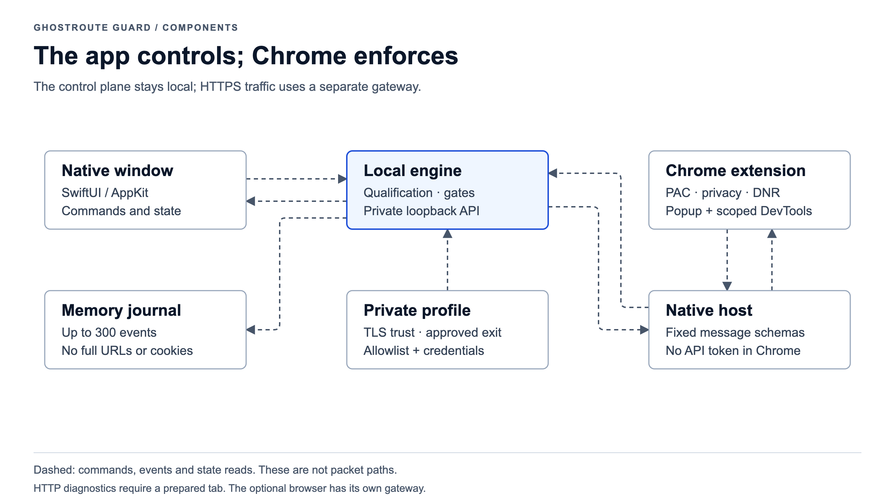
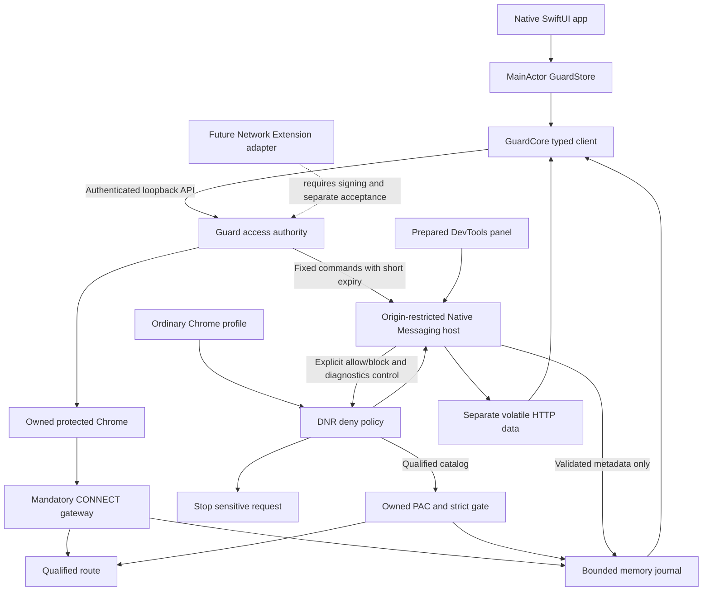
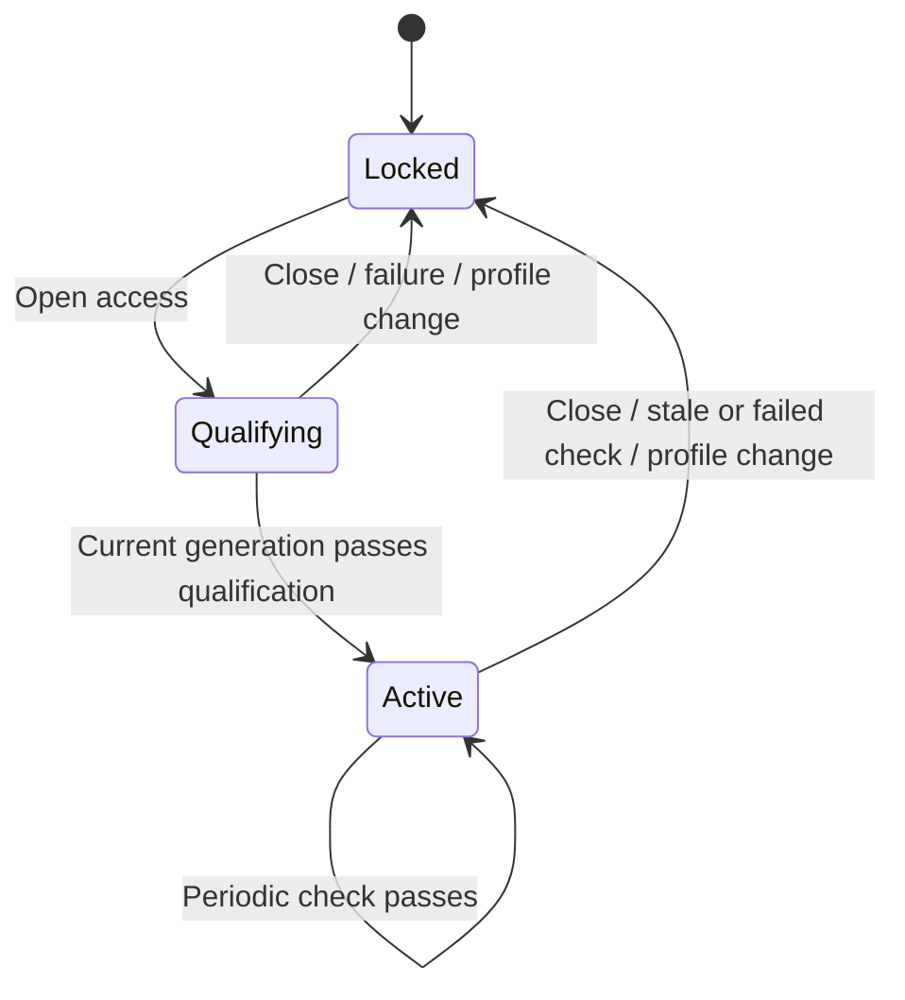

# Native application and Chrome integration

## Scope

GhostRoute Guard is a local SwiftUI application for one operator. It controls an
ordinary Chrome's catalog through an explicitly installed extension and mandatory
qualified proxy. A dedicated browser remains optional. No
component silently changes router channels or the system-wide proxy.

Native access controls, a memory journal, Chrome rule-match delivery, explicit
per-tab HTTP diagnostics and app-to-Chrome controls are implemented. The Chrome
agent supplies this control plane without a system extension. System-wide
filtering remains outside this module's installed scope.

For independent third-party VPN controls, enable Guard only in a dedicated
regular Chrome profile. Leave other profiles without an enabled Guard extension;
their own extensions retain policy ownership. The native app and installed host
are shared, while agent state and CONNECT gates remain isolated. This regular
profile is distinct from the optional fixed-proxy browser owned by the launcher.
Native applications and CLI clients do not enter either gate automatically.

## Components and ownership

[Editable English figures](../../../docs/assets/diagrams/ghostroute-guard-en.html) ·
[Русские схемы](../../../docs/assets/diagrams/ghostroute-guard-ru.html)

| Component | Owns | Boundary |
|---|---|---|
| `GuardApp` | AppKit lifecycle, one window, owned Python child, bootstrap pipe | Custom URL focuses only; no untrusted URL/route commands |
| `GuardUI` | SwiftUI sidebar, standard controls/table, MainActor state, selection/filter/search | Never decides route eligibility; no credentials in UI models |
| `GuardCore` | Typed Codable contracts, fixed API actions, ephemeral URLSession | Accepts only literal loopback bootstrap with per-run bearer; removes token fragment |
| Python Guard | Qualification, generation/cancellation, catalogs, connections and counters | Sole authority for opening access; startup/restart is locked |
| Protected browser owner | Separate Chrome profile and mandatory fixed proxy | Launch flags and route restrictions remain enforced independently of view state |
| Chrome policy agent | Explicit DNR deny policy in each enabled ordinary profile | Sensitive sites remain denied even while protected-browser access is open |
| Chrome native bridge | Validated events and fixed access/diagnostic commands over private Unix socket | No dashboard token, route action, shell command, arbitrary URL or file operation |
| Strict coordinator | Per-agent qualified CONNECT gates, catalog scope and tunnel draining | Separate from the optional browser; never changes router policy |
| `strict.js` / `pac.js` | Owned mandatory PAC, local external-PAC snapshot composition and privacy settings | Explicit `proxy`/`privacy`; competing settings close admission |
| Chrome diagnostics | Prepared DevTools tab, 60-second capture, up to 100 entries and solicited text preview | Separate volatile store, 1024-character preview for 15 seconds; never the activity journal |
| Journal | Last 300 events plus bounded active-connection references | Memory only; no raw URL, cookies, headers, body or exception dump |

Startup failures use a narrow error-code bootstrap contract. The shell presents
actionable messages, retains up to 32 local failure events within the shared
300-event display limit, and offers an owned-backend retry. API loss disables
access controls; successful reconnection clears the connection warning. A second
native launch activates the existing instance. The gate reuses a released address
after TIME_WAIT but never enables SO_REUSEPORT or shares a live listener.

Closing the last window leaves the app and engine running. The retained window
can be reopened from the Dock or the existing custom URL; explicit Quit stops
the engine. A popup launch uses the installed Native Messaging host with a
fixed installer-owned bundle path and `--background`, without changing access
authority. The initial background launch does not steal focus from Chrome.

The shell holds a `BackendActivity` for the owned engine's lifetime. It uses
`ProcessInfo.beginActivity(.userInitiatedAllowingIdleSystemSleep)` so App Nap
does not defer the active gateway when its window is covered or minimized.
Failed launch, child exit and normal shutdown release the assertion exactly once.
It does not prevent display/system sleep, extend route evidence expiry, or allow
an unqualified path after wake. See Apple's
[app-level activity guidance](https://developer.apple.com/library/archive/documentation/Performance/Conceptual/power_efficiency_guidelines_osx/PrioritizeWorkAtTheAppLevel.html).

Python and protected Chrome launches strip inherited AppKit bundle-identity
environment values so each executable discovers its own bundle. Chrome receives
the fixed proxy on every launch, an explicit Default profile, and a new window on
first launch. An early child exit is a failure, not a successful open. The engine
returns only its owned browser PID; the shell verifies the running application's
Chrome bundle ID before activating it. Failed focus leaves manual-switch guidance.

An open action checks route/catalog eligibility before invoking Chrome and records
only the destination host and a fixed result reason. Successful process launch is
not page-load evidence. UI labels distinguish Guard access from ordinary Chrome's
independent deny policy. Filters expose visible/total counts and a reset action;
the blocked metric selects all block sources, and an event action opens only the
recorded host as HTTPS through the same qualified browser path.

## State and UI contract

The main overview controls ordinary Chrome: Open/Close access applies to the
selected extension agent and displays its actual DNR state separately from the
requested state. Strict mode requires a trusted route profile, but no DevTools. The existing
blocked page must be refreshed; no tab is automatically moved or reloaded.
Ordinary Chrome's catalog uses the mandatory gate and qualified HTTPS route.
Other destinations use the Mac network by default; the home router retains
managed/direct ownership. The controller drops old embedded provider snapshots
when upgrading to this mode. External inline PAC composition requires the explicit
local installer setting `external_pac`. Provider authentication stays with its enabled
extension; country/server changes are not live-synchronized. The snapshot remains
only in Chrome settings, never in Native Messaging or the journal. See [strict mode](strict-mode.md).
The popup provides the same access buttons for its own ephemeral agent. It sends
only a boolean request through the existing native bridge, and the engine queues
the same allow/block commands. Only the extension's own popup URL is accepted by
the worker; no dashboard token or route controls are exposed. Engine absence
disables Open. Popup and native UI both show actual rule state.
The dedicated browser's controls and tunnel metrics live in a collapsed optional
section. Its independent gateway state machine is shown below.

Ordinary Chrome metrics count catalog request-rule decisions, with separate
allow/block totals. Metric actions select the corresponding Chrome journal filter.
They never populate gateway tunnel/byte counters. An allow match does not prove
HTTP completion; Chrome decision rows show no invented transfer or duration.
The extension's worker lifetime differs from the engine's delivered-event lifetime.
Chrome polls the existing native channel every 500 ms. A native access click
follows only the small Chrome snapshot at 100 ms for up to 1.5 seconds, stopping
on actual state and acknowledgement or a newer action. Idle journal polling
remains 1.5 seconds. Real-browser tests gate both directions below two seconds
over 16 switches; OS sleep/process stalls remain outside a hard latency guarantee.

Route selection alone does not open access. The UI enables browsing only while
the engine reports active and the API is reachable. Close stays available during
qualification. A newer UI action invalidates older replies; the engine separately
uses generations and drains tracked sockets. Loss of the control API disables
open/browse actions; the connection indicator reports loss while counters retain
their last displayed values. Quitting the application also terminates its owned
gateway and browser, independently of control-API availability.
Only the engine grants access; a green UI cannot create a direct fallback.

## Ordinary Chrome as a separate traffic-control boundary

The Chrome integration enforces the installed sensitive deny catalog, reports
health/blocks, and accepts a fixed app command set. It does not acquire proxy
ownership or route authority. Native Messaging replies carry expiring commands
for one ephemeral agent; acknowledgements and actual state are shown separately.
The schemas have no arbitrary URL, request headers/body, tab ID or control token.
Solicited text previews use a separate bounded schema and volatile store.
The manifest permits only the ID derived from this unpacked extension's absolute
path; moving that path requires re-registration. Chrome may require accepting
new permissions/reloading the extension after upgrade.

The agent's rule match is a browser-reported fact, not evidence that every Chrome
profile is protected. A fresh heartbeat confirms one reporting ruleset only.
When Guard is absent, DNR continues enforcement and event delivery fails; no
sensitive disk spool or automatic replay is created. A bounded in-flight queue
drops excess signals without weakening deny rules. Native startup/health status
must never be inferred to qualify a third-party VPN. Explicit Open access uses
a higher-priority session allow rule while the static ruleset stays enabled.
Native replies renew a 15-second lease while the app wants access open; there is
no one-minute user limit. Agent silence beyond 6 seconds removes its desired
access from the engine. Lease expiry, detected app loss and worker startup remove it;
browser restart clears session rules. Timer scheduling is a browser boundary,
not instantaneous OS enforcement. The app cannot re-enable an extension that
the operator disabled through Chrome itself.

Ordinary-profile proxy/PAC control is the separate `strict.js` capability with
per-agent qualification and actual proxy/privacy ownership. Owned PAC/privacy
remain on pause or engine loss, pointing at a closed local gate: restoring
prediction can create speculative CONNECT before DNR. Operator disabling/removal
lets Chrome restore its lower-layer settings. The implemented DevTools diagnostic component is separate from the deny
policy: opening its panel and granting control prepares one inspected tab;
app commands start/stop/clear capture and request one text response. Hiding the
panel revokes the grant. Navigation clears previous responses. No debugger
permission, TLS interception certificate or arbitrary script command is used.
See [Chrome agent contract](chrome-agent.md).

## Automatic route-based admission

Enforced admission is implemented; a probe-only observer is not shipped.
A successful qualification of the
optional gateway must never automatically open ordinary Chrome: those traffic
paths can differ. Wi-Fi name, default gateway, VPN icon and country lookup alone
are insufficient evidence. Approved exits come from the private trusted profile,
never from automatically trusting the current observed address.

Two designs have different guarantees:

| Design | Required control/evidence | Limit |
|---|---|---|
| Enforced sensitive route | Ordinary Chrome sends catalog destinations through an owned mandatory proxy/gateway; qualified transport, catalog coverage and approved exit | Requires explicit Chrome proxy ownership, compatibility and no-DIRECT acceptance; a competing proxy extension cannot silently be overridden |
| Observe current path | A fresh HTTPS probe from the intended Chrome profile through its existing network, plus reviewed routing policy | Proves that probe at that time; PAC can send another URL differently and the network can change after the probe. Not a per-connection no-leak guarantee |

For enforced routing, qualification must complete before forwarding application
bytes. Every new sensitive CONNECT uses only the controlled transport; failure
has no direct retry. The ordinary-profile adapter is a separate capability from
the event/diagnostic agent. Do not silently repurpose the existing global manual
allow rule or seize Browsec/Red Shield settings. Non-sensitive routing and router
channel ownership remain explicit compatibility contracts.

Admission state is **blocked → checking → verified**, returning to blocked
on failed/expired evidence, route or proxy ownership change, suspend/resume,
engine/worker restart or loss of control. Use monotonic expiry and generations:
a late successful check cannot undo a newer Close action. Manual Close suspends
automatic opening for that agent until Resume or a new engine run. Close drains
tracked strict tunnels; owned PAC/privacy remain in place.

Native and popup UI must distinguish checking, verified route, stale evidence
and blocked with a fixed safe reason. Warnings belong in both interfaces and
the memory journal; a notification permission is a separate opt-in. Previously
blocked pages require an explicit retry, not background tab reloads. Existing
streams need separate draining where the gateway owns them; changing DNR alone
does not terminate established WebSockets.

Acceptance must cover a canary succeeding while another destination bypasses it,
competing PAC/proxy ownership, route change immediately after success, wrong
exit/certificate, stale/cached/redirected probes, failed renewal, startup/sleep,
engine death and Close during qualification. Measure fast local switching
separately from remote qualification latency. Never claim an unconditional
two-second remote verification deadline or instant OS-wide enforcement.

Full lifecycle, timing and reviewed-catalog limits, including outside-catalog
TURN TCP, are documented in [strict mode](strict-mode.md).

References: [Chrome proxy settings](https://developer.chrome.com/docs/extensions/reference/api/proxy)
and [Chromium per-URL proxy resolution](https://chromium.googlesource.com/chromium/src/+/HEAD/net/docs/proxy.md).

## Optional protection without a Chrome extension

The dedicated protected browser already works without an extension. Extending
enforcement to ordinary Chrome or other Mac applications calls for a distinct
macOS Network Extension/filter adapter, with Developer ID entitlements, OS
approval, lifecycle/recovery and compatibility acceptance. A socket filter may
not receive a hostname, so a precise sensitive-domain guarantee cannot simply
be copied from DNR. A whole-process deny policy when no route is qualified is
the more conservative design to evaluate. System proxy settings alone do not
prove interception of all application traffic.

This adapter is an architectural boundary, not an installed component or an
unused placeholder implementation. Do not disable platform security to make an
ad-hoc signed system extension load. See Apple's
[Network Extension entitlement](https://developer.apple.com/documentation/bundleresources/entitlements/com.apple.developer.networking.networkextension)
and [optional remote hostname](https://developer.apple.com/documentation/networkextension/nefiltersocketflow/remotehostname).

## Verification and delivery

- Python fixtures prove routing/qualification, close/cancellation, byte accounting,
  bounded journal and redaction, API authentication and private event schemas.
- Dependency-free Swift checks prove typed transport, bootstrap constraints,
  no token in API URL, state controls, lost connection and stale-response handling.
- Real browser fixtures prove gateway failure behavior, no DNS/WebRTC/direct
  bypass, ordinary main-frame/subresource blocks and the full native event path.
- Build/sign the app before replacing the installed bundle. Keep a local rollback
  bundle and the existing private profile; new launch starts locked.
- Visually verify the actual SwiftUI window, standard table/selection, route
  controls and settings. Installation is not evidence of live route acceptance.

Private release evidence belongs under ignored `reports/`, never public docs.
