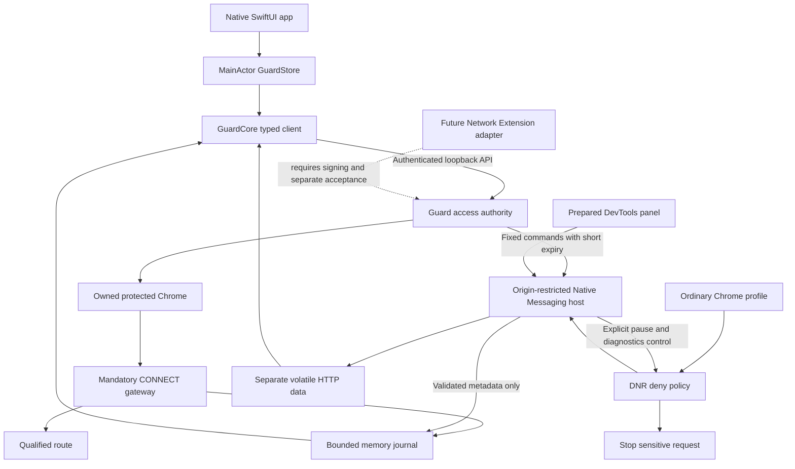
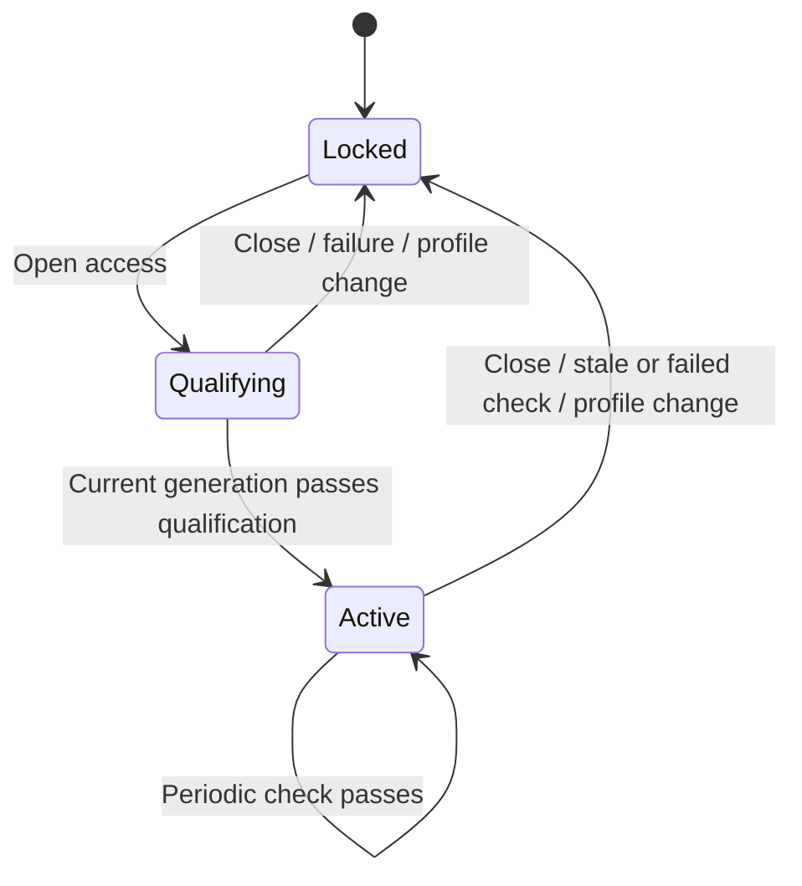

# Native application and Chrome integration

## Scope

GhostRoute Guard is a local SwiftUI application for one operator. It controls an
independent fail-closed gateway and dedicated Chrome profile. Ordinary Chrome has
an explicitly installed deny policy and reports its own block metadata. No
component silently changes router channels or the system-wide proxy.

Native access controls, a memory journal, Chrome rule-match delivery, explicit
per-tab HTTP diagnostics and app-to-Chrome controls are implemented. The Chrome
agent supplies this control plane without a system extension. System-wide
filtering remains outside this module's installed scope.

## Components and ownership

| Component | Owns | Boundary |
|---|---|---|
| `GuardApp` | AppKit lifecycle, one window, owned Python child, bootstrap pipe | Custom URL focuses only; no untrusted URL/route commands |
| `GuardUI` | SwiftUI sidebar, standard controls/table, MainActor state, selection/filter/search | Never decides route eligibility; no credentials in UI models |
| `GuardCore` | Typed Codable contracts, fixed API actions, ephemeral URLSession | Accepts only literal loopback bootstrap with per-run bearer; removes token fragment |
| Python Guard | Qualification, generation/cancellation, catalogs, connections and counters | Sole authority for opening access; startup/restart is locked |
| Protected browser owner | Separate Chrome profile and mandatory fixed proxy | Launch flags and route restrictions remain enforced independently of view state |
| Chrome policy agent | Explicit DNR deny policy in each enabled ordinary profile | Sensitive sites remain denied even while protected-browser access is open |
| Chrome native bridge | Validated events and fixed diagnostic/pause commands over private Unix socket | No dashboard token, route action, shell command, arbitrary URL or file operation |
| Chrome diagnostics | Prepared DevTools tab, 60-second capture, up to 100 entries and solicited text preview | Separate volatile store, 1024-character preview for 15 seconds; never the activity journal |
| Journal | Last 300 events plus bounded active-connection references | Memory only; no raw URL, cookies, headers, body or exception dump |

Startup failures use a narrow error-code bootstrap contract. The shell presents
actionable messages, retains up to 32 local failure events within the shared
300-event display limit, and offers an owned-backend retry. API loss disables
access controls; successful reconnection clears the connection warning. A second
native launch activates the existing instance. The gate reuses a released address
after TIME_WAIT but never enables SO_REUSEPORT or shares a live listener.

Python and protected Chrome launches strip inherited AppKit bundle-identity
environment values so each executable discovers its own bundle. Chrome receives
the fixed proxy on every launch, an explicit Default profile, and a new window on
first launch. An early child exit is a failure, not a successful open. The engine
returns only its owned browser PID; the shell verifies the running application's
Chrome bundle ID before activating it. Failed focus leaves manual-switch guidance.

An open action checks route/catalog eligibility before invoking Chrome and records
only the destination host and a fixed result reason. Successful process launch is
not page-load evidence. UI labels distinguish Guard access from ordinary Chrome's
independent deny policy. Filters expose visible/total counts and a reset action;
the blocked metric selects all block sources, and an event action opens only the
recorded host as HTTPS through the same qualified browser path.

## State and UI contract

Route selection alone does not open access. The UI enables browsing only while
the engine reports active and the API is reachable. Close stays available during
qualification. A newer UI action invalidates older replies; the engine separately
uses generations and drains tracked sockets. Loss of the control API disables
open/browse actions; the connection indicator reports loss while counters retain
their last displayed values. Quitting the application also terminates its owned
gateway and browser, independently of control-API availability.
Only the engine grants access; a green UI cannot create a direct fallback.

## Ordinary Chrome as a separate traffic-control boundary

The Chrome integration enforces the installed sensitive deny catalog, reports
health/blocks, and accepts a fixed app command set. It does not acquire proxy
ownership or route authority. Native Messaging replies carry expiring commands
for one ephemeral agent; acknowledgements and actual state are shown separately.
The schemas have no arbitrary URL, request headers/body, tab ID or control token.
Solicited text previews use a separate bounded schema and volatile store.
The manifest permits only the ID derived from this unpacked extension's absolute
path; moving that path requires re-registration. Chrome may require accepting
new permissions/reloading the extension after upgrade.

The agent's rule match is a browser-reported fact, not evidence that every Chrome
profile is protected. A fresh heartbeat confirms one reporting ruleset only.
When Guard is absent, DNR continues enforcement and event delivery fails; no
sensitive disk spool or automatic replay is created. A bounded in-flight queue
drops excess signals without weakening deny rules. Native startup/health status
must never be inferred to qualify a third-party VPN. An explicitly confirmed
60-second pause uses a higher-priority session allow rule while the static
ruleset stays enabled. Expiry, detected app loss and worker startup remove it;
browser restart clears session rules. Timer scheduling is a browser boundary,
not instantaneous OS enforcement. The app cannot re-enable an extension that
the operator disabled through Chrome itself.

Future ordinary-profile proxy/PAC control would require a separate capability,
an explicit owner of proxy settings, proof of no DIRECT/UDP bypass, per-profile
qualification and restore on removal. It must not be introduced through the
agent. The implemented DevTools diagnostic component is separate from the deny
policy: opening its panel and granting control prepares one inspected tab;
app commands start/stop/clear capture and request one text response. Hiding the
panel revokes the grant. Navigation clears previous responses. No debugger
permission, TLS interception certificate or arbitrary script command is used.
See [Chrome agent contract](chrome-agent.md).

## Optional protection without a Chrome extension

The dedicated protected browser already works without an extension. Extending
enforcement to ordinary Chrome or other Mac applications calls for a distinct
macOS Network Extension/filter adapter, with Developer ID entitlements, OS
approval, lifecycle/recovery and compatibility acceptance. A socket filter may
not receive a hostname, so a precise sensitive-domain guarantee cannot simply
be copied from DNR. A whole-process deny policy when no route is qualified is
the more conservative design to evaluate. System proxy settings alone do not
prove interception of all application traffic.

This adapter is an architectural boundary, not an installed component or an
unused placeholder implementation. Do not disable platform security to make an
ad-hoc signed system extension load. See Apple's
[Network Extension entitlement](https://developer.apple.com/documentation/bundleresources/entitlements/com.apple.developer.networking.networkextension)
and [optional remote hostname](https://developer.apple.com/documentation/networkextension/nefiltersocketflow/remotehostname).

## Verification and delivery

- Python fixtures prove routing/qualification, close/cancellation, byte accounting,
  bounded journal and redaction, API authentication and private event schemas.
- Dependency-free Swift checks prove typed transport, bootstrap constraints,
  no token in API URL, state controls, lost connection and stale-response handling.
- Real browser fixtures prove gateway failure behavior, no DNS/WebRTC/direct
  bypass, ordinary main-frame/subresource blocks and the full native event path.
- Build/sign the app before replacing the installed bundle. Keep a local rollback
  bundle and the existing private profile; new launch starts locked.
- Visually verify the actual SwiftUI window, standard table/selection, route
  controls and settings. Installation is not evidence of live route acceptance.

Private release evidence belongs under ignored `reports/`, never public docs.
