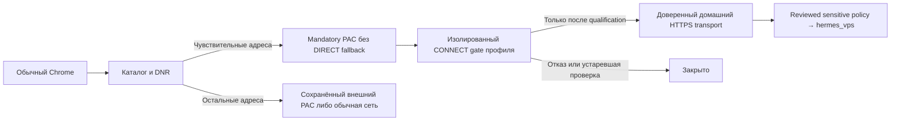

# Авто GhostRoute в обычном Chrome

Строгий режим отправляет чувствительный каталог обычного Chrome через собственный
loopback CONNECT-шлюз, затем через уже настроенный домашний HTTPS-транспорт.
Отдельный браузер необязателен. Клиентские импорты, роутер и каналы не меняются.

## Условия допуска

1. Приватный профиль содержит ровно один подходящий `https_proxy` маршрут.
   Его allowlist покрывает весь sensitive-каталог; HTTPS canary относится к той
   же policy. Ожидаемые IP выхода и TLS trust заданы заранее доверенным путём.
2. Каталог расширения совпадает с профилем приложения по SHA-256.
3. У Chrome исходный proxy mode `direct`, `system` либо доступный inline PAC.
   macOS сообщает отсутствие системного proxy/PAC/WPAD. Внешний inline PAC
   сохраняется для остальных назначений; remote PAC, fixed proxy и неизвестное
   состояние дают отказ вместо молчаливой замены на DIRECT.
4. Расширение фактически владеет своей mandatory PAC-конфигурацией, запретом
   непроксированного WebRTC UDP и отключением speculative network prediction.
   Разрешения `proxy` и `privacy` принимаются оператором при обновлении.
5. Домашний транспорт проходит полную HTTPS-проверку с заранее разрешённым
   выходом. Браузер не получает upstream credentials или API token.



## Автомат состояний

Запуск начинается с блокировки. Пока proxy ownership не подтверждено, target
запросы не допускаются. После qualification DNR session allow включается только
при фактическом владении PAC/privacy и действующем подтверждении engine.

На один временный агент Chrome создаётся отдельный gate, максимум восемь.
HTTPS-проверка обновляется примерно каждые пять секунд; доказательство старше
десяти секунд закрывает gate и tracked tunnels. Проверка системного proxy —
раз в две секунды. Утрата сигнала агента старше шести секунд удаляет его gate.
После неудачи проверка повторяется автоматически, без direct retry.
На каждом новом CONNECT gate повторно проверяет срок, поколение и каталог;
upstream TLS identity проверяется до отправки credentials.

«Закрыть доступ» приостанавливает авто для выбранного агента и сразу разрывает
его tracked tunnels. «Возобновить авто» запускает новую qualification. Поздний
успех отменённой проверки не отменяет Close. Пауза хранится в памяти текущего
engine; новый запуск снова начинает с блокировки и автоматической проверки.
Импорт профиля закрывает строгие lanes и требует явного возобновления.

При паузе и потере приложения **owned PAC сохраняется**, указывая на закрытый
или недоступный локальный gate; privacy guards также сохраняются. Одного DNR
недостаточно против speculative CONNECT до HTTP-проверки. Отключение/удаление
расширения самим оператором снимает его настройки Chrome и завершает защиту.

## Proxy и совместимость

Конкурирующий владелец proxy/privacy, политика Chrome или неподдерживаемая
конфигурация показываются в приложении и popup; чувствительные сайты закрываются.
Guard не отключает Browsec/Red Shield. Если текущий inline PAC доступен и Chrome
позволяет управление, Guard сохраняет его снимок внутри собственной mandatory PAC.
Правило sensitive-каталога выполняется первым; остальные URL делегируются прежней
`FindProxyForURL` с её bypass/fallback правилами. Расширение провайдера остаётся
включённым, в том числе для proxy authentication. Эффективный владелец настройки
при этом один — Guard; это композиция правил, а не два независимых владельца.

Снимок ограничен 1 MiB и остаётся только в настройках Chrome, включая локальные
служебные данные исходного PAC. Он не передаётся в приложение, Native Messaging,
журнал или Git. При перезапуске worker/app Guard извлекает снимок из своей PAC
и обновляет только порт gate. Ошибка PAC не вызывает DIRECT fallback.

**Смена страны/сервера в Browsec не обновляет снимок автоматически.** Для нового
снимка закройте доступ, отключите Guard extension, выберите и проверьте нужный
маршрут провайдера, затем включите Guard и дождитесь новой qualification. Во время
отключения Guard его защита отсутствует: чувствительные сайты не открывайте.
Не используйте это как автоматический failover. Удалённый PAC и `fixed_servers`
в этой версии не компонуются; владелец с более высоким приоритетом или policy
остаётся конфликтом. Реакция на внешнее изменение асинхронна: это не атомарный
системный firewall против другого расширения или процесса, меняющего Chrome.

Privacy guards действуют на regular-профиль целиком: WebRTC UDP и speculative
prediction отключаются, что может изменить работу звонков/предзагрузки.
При изменении системного proxy во время сессии требуется согласовать владение;
Guard сохраняет закрытие sensitive lane и не обещает автоматически совместить
новый OS proxy с уже установленной PAC. Другие профили/Incognito требуют отдельной
активации и приёмки. Выключенное расширение не считается защищённым.

## Граница каталога

Гарантия относится к перечисленным назначениям, не ко всем ресурсам вкладки.
Новый CDN, IP literal или TURN-сервер вне каталога может использовать обычную сеть.
`disable_non_proxied_udp` не означает запрет всего WebRTC TCP: реальный browser
fixture отдельно демонстрирует TCP к TURN вне каталога. Проверенный TURN-адрес
внутри каталога, напротив, не получает прямого обхода. Полную изоляцию вкладки,
DNS всего Mac, сокрытие аккаунта/fingerprint или произвольных внешних ресурсов
этот селективный режим не обещает. Дополнение каталога требует review зависимостей
и server-side sensitive policy, без широкого автоматического добавления CDN.

## Журнал, скорость и приёмка

DNR allow/block counts остаются решениями правил. Источник «Chrome через Guard»
добавляет реальные CONNECT-решения, байты TLS-туннелей, закрытие и ошибки в общий
журнал памяти; отдельные strict counters не смешиваются с optional browser.

Локальные команды и подтверждение UI проверяются отдельно от сетевой qualification.
Первая/повторная HTTPS-проверка может занять больше двух секунд при медленной сети;
в это время доступ остаётся закрытым, UI показывает проверку или причину отказа.

```bash
./modules/mac-privacy-guard/tests/run.sh
swift run --package-path modules/mac-privacy-guard/native GuardNativeChecks
node modules/mac-privacy-guard/tests/strict-browser.mjs
node modules/mac-privacy-guard/tests/pac.mjs
```

Fixture использует disposable Chrome profiles, локальные TLS endpoints и второй
настоящий extension-владелец proxy. Проверяет отсутствие target data до проверки,
автоматическое открытие, Close/Resume, сохранение паузы, proxy/OS конфликты,
восстановление маршрута, dead gate/engine, UDP/TCP tripwires и границу внешнего TURN.
Дополнительно проверяются одновременно внешний PAC с реальной fixture proxy
authentication для HTTP/HTTPS и отдельный sensitive gate, сохранение внешнего
пути на паузе и отсутствие исходного PAC в native API. Unit PAC проверяет
suffix-границы, восстановление снимка и защиту entry point от изменения globals.
Production TLS/pin/exit rejection покрываются transport tests. Затем отдельно
проверяются установленное расширение, его разрешения и реальный approved маршрут.

Источники: [Chrome proxy](https://developer.chrome.com/docs/extensions/reference/api/proxy),
[Chrome privacy](https://developer.chrome.com/docs/extensions/reference/api/privacy),
[Chromium proxy behavior](https://chromium.googlesource.com/chromium/src/+/HEAD/net/docs/proxy.md),
[WebRTC IP handling](https://chromium.googlesource.com/chromium/src/+/HEAD/components/policy/resources/templates/policy_definitions/Miscellaneous/WebRtcIPHandling.yaml).
