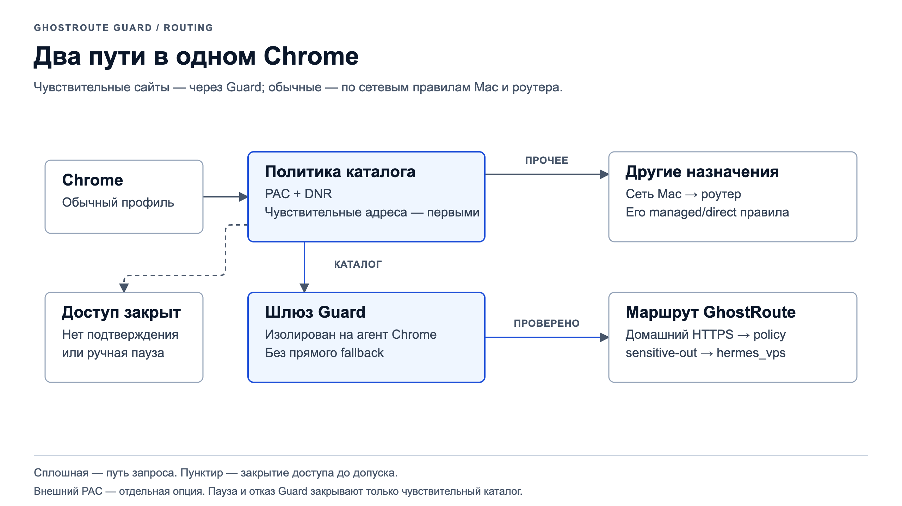
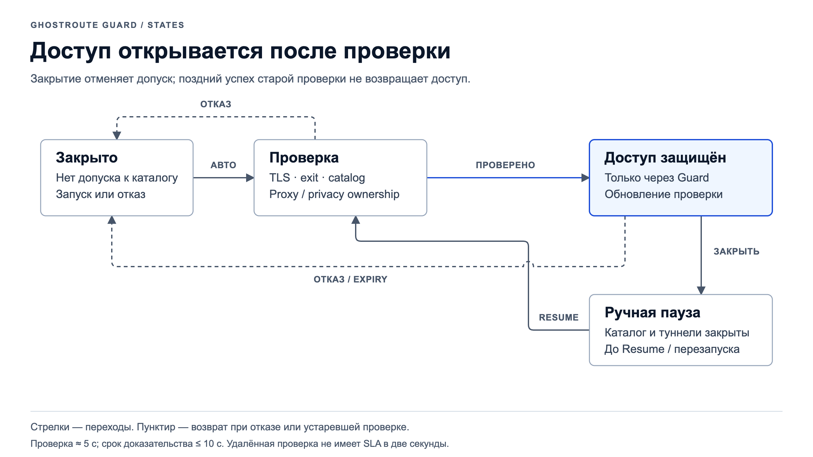

# GhostRoute Guard: руководство пользователя

Большие числа в popup сокращаются: `1,1k` — тысячи, `12,3M` — миллионы.
Badge содержит максимум четыре символа (`14k`). Точные значения с разделителями
видны при наведении на число и в «Подробности и точные счётчики». Вертикальные
линии разделяют общий итог, разрешения и блокировки; подробности свёрнуты,
а длинный popup прокручивается.
Подтверждённый маршрут выделяется зелёным. Оранжевый означает открытый доступ
без strict-проверки маршрута; закрытый доступ показан нейтральным цветом.

Guard управляет чувствительными сайтами в обычном Google Chrome. Нативное
приложение и popup расширения показывают одно состояние выбранного профиля.
Отдельный защищённый браузер — дополнительная опция.

Для независимых кнопок Guard и стороннего VPN используйте отдельные профили:
**«GhostRoute Guard» — с Guard; остальные — со своими расширениями и правилами**.
Приложение Mac остаётся общим, но не перехватывает сеть остальных приложений.

[Открыть редактируемые схемы](../../../docs/assets/diagrams/ghostroute-guard-ru.html) ·
[English](../../../docs/assets/diagrams/ghostroute-guard-en.html)

## Первый запуск

1. Откройте `~/Applications/GhostRoute Guard.app`. Это пользовательская папка
   Applications, отдельная от системной `/Applications`.
2. Если приложение ещё не установлено, выполните [установку](../README.md#быстрый-старт).
   Для маршрута нужен заранее подготовленный приватный профиль по
   [инструкции оператора](operations.md#приватный-профиль).
3. Создайте выделенный профиль по [инструкции ниже](#отдельный-профиль-guard).
   В нём откройте `chrome://extensions`, включите режим разработчика и
   загрузите папку `~/Library/Application Support/GhostRoute Guard/Chrome Blocker`.
   Кнопка «Показать папку расширения» находится в настройках Guard.
4. При обновлении нажмите Reload у расширения и примите разрешения `proxy` и
   `privacy`, если Chrome их запросит. В других профилях оставьте Guard выключенным
   или неустановленным. Incognito требует отдельного разрешения и проверки.
5. Оставьте приложение запущенным. Дождитесь **«Авто GhostRoute: доступ защищён»**,
   затем открывайте сайт в той же вкладке обычного Chrome. Страницу с прежней
   ошибкой `ERR_BLOCKED_BY_CLIENT` нужно обновить вручную.

Индикатор «Служба на связи» подтверждает связь окна с локальным процессом.
Он сам по себе не подтверждает маршрут. Для этого служит основной статус доступа.

Красная кнопка закрывает только окно Guard; служба продолжает работать.
Вернуть окно можно из Dock или по ссылке «Открыть приложение Guard» в расширении.
Полностью завершить приложение можно через меню «Завершить GhostRoute Guard» или
⌘Q. В этом случае popup показывает **«Guard не на связи»** и активную кнопку
**«Запустить Guard»**. Она запускает установленное приложение, ждёт связи и
проверки маршрута. До подтверждения чувствительный каталог остаётся закрыт.
Если запуск не удался, popup предлагает открыть приложение и проверить установку.

## Отдельный профиль Guard

1. В меню Chrome **Profiles / Профили → Add Profile / Добавить профиль** создайте
   локальный профиль **GhostRoute Guard**. Для работы Guard вход в Google и Sync
   не нужны. Отличающаяся тема помогает узнавать его окно.
2. Загрузите уже установленную папку `Chrome Blocker` именно в этом профиле.
   Не копируйте папку расширения: прежний путь сохраняет его ID и регистрацию
   Native Messaging host. Профиль с маршрутом в приложении Mac остаётся прежним.
3. В остальных профилях откройте `chrome://extensions` и выключите Guard, если он
   там был включён. Другие расширения, их настройки, cookies и входы оставьте на месте.
4. В профиле Guard дождитесь защищённого статуса. В другом профиле пользуйтесь
   своим VPN и его обычными кнопками. Не устанавливайте конкурирующий proxy VPN
   в профиль Guard: один профиль имеет только одну эффективную proxy-настройку.

Переключайтесь через меню **Profiles → GhostRoute Guard** или выбирайте свой
обычный профиль. Оба окна могут работать одновременно. Кнопки Guard относятся
только к выбранному подключённому агенту, а popup — к своему профилю.

Этот профиль **не является** дополнительным браузером из сворачиваемой панели
«Открыть в Guard»: тот использует отдельный каталог `Browser/`, launch flags и
собственный шлюз. Для выделенного профиля с расширением эта опция не нужна.

| Где открыт запрос | Кто управляет доступом |
|---|---|
| Чувствительный сайт в профиле с Guard | Guard: проверенный маршрут или блокировка |
| Обычный сайт в профиле с Guard | Текущая сеть Mac и существующая политика роутера |
| Другой профиль без Guard | Его собственные proxy/VPN/расширения и сеть Mac |
| Нативное приложение, CLI или другой браузер без Guard | Сеть Mac; Guard не перехватывает и не блокирует эти запросы |

Зелёный статус Guard не означает защиту всего компьютера. Системный сетевой фильтр
не установлен. Вне профиля с расширением отсутствует именно блокировка Guard;
действующие правила домашнего роутера и других средств защиты от этого не исчезают.

## Доступ и поведение при отказе

| Статус или действие | Что происходит |
|---|---|
| Проверка маршрута | Каталог закрыт, пока не подтверждены настройки Chrome, TLS и ожидаемый выход |
| Доступ защищён | Каталог идёт через обязательный локальный шлюз и проверенный домашний HTTPS-маршрут |
| Закрыть доступ | Автопроверка выбранного агента приостановлена; новые запросы блокируются, его открытые туннели закрываются |
| Возобновить авто | Начинается новая проверка; это не разрешение прямого выхода |
| Потеря приложения или маршрута | Каталог закрывается; сохранённый proxy продолжает указывать на закрытый локальный шлюз |
| Новый запуск приложения | Начинается с закрытого доступа и автоматической проверки; прежняя ручная пауза не сохраняется на диск |

Те же кнопки доступны в popup. Закрытие одного агента не закрывает другой профиль
Chrome или дополнительный браузер. Удаление/отключение расширения в Chrome снимает
его защиту; приложение не может включить выключенное расширение обратно.

## Одновременно с внешним proxy

Для независимой работы расширений используйте [разные профили](#отдельный-профиль-guard).
Описанный ниже `external_pac` — дополнительная совместимость внутри одного профиля;
для разделённых профилей она не требуется.

Основной режим — **обычная сеть Mac**. Все сайты вне чувствительного каталога
используют текущий маршрут компьютера. Дома роутер применяет свою managed/direct
схему, без отдельного списка правил в Guard. В другой сети обычные сайты идут
через неё; доступ к чувствительным всё равно требует проверенного GhostRoute.
Пауза и отказ Guard не закрывают обычные сайты после установки его PAC.

Совместимость с внешним proxy включается отдельно [операторской настройкой](operations.md#одновременно-с-proxy-расширением-chrome)
`external_pac`; по умолчанию она выключена. В этом режиме
совместимый inline PAC внешнего расширения сохраняется как локальный снимок.
Чувствительный каталог проверяется первым и направляется через Guard. Для
остальных сайтов сначала учитываются [проверенные приватные исключения](operations.md#проверенные-исключения-обычных-сайтов),
затем прежние правила внешнего PAC, включая его собственные исключения.
Внешнее расширение остаётся включённым для авторизации proxy; эффективными
настройками proxy Chrome владеет Guard.

Это совместимость маршрутов, а не двух независимых переключателей VPN.
Другой VPN может показывать «proxy занят другим расширением». Его кнопка
исправления конфликта может отключить Guard целиком. Не используйте её для
восстановления Guard: проверьте, что Guard включён в `chrome://extensions`,
затем запускайте службу из его popup. Границы совместимости описаны в
[строгом режиме](strict-mode.md#proxy-и-совместимость).

**Смена страны или сервера во внешнем расширении не обновляет снимок автоматически.**
Для обновления следуйте [порядку повторного получения снимка](strict-mode.md#proxy-и-совместимость).
Во время отключения Guard его защита отсутствует. Remote PAC, `fixed_servers`,
системный proxy и недоступное владение настройками требуют отдельного согласования;
Guard показывает отказ, а не незаметно заменяет их прямым выходом.

## Журнал: запросы и соединения

| Показатель | Что измеряет | Чего не подтверждает |
|---|---|---|
| Запросов Chrome / разрешено / заблокировано | Срабатывания правил чувствительного каталога | Успех ответа сайта, число TCP-соединений или весь трафик Chrome |
| Число на иконке расширения | Сумму разрешений и блокировок за запуск worker | Совпадение со счётчиками приложения после независимых перезапусков |
| Chrome через Guard | Реальные туннели и байты внутри них, включая TLS | HTTP-тела, полезную нагрузку страницы или трафик всего Mac |
| HTTP-диагностика | Статусы и время завершённых ответов одной подготовленной вкладки | Наблюдение за всеми вкладками в фоне |

Журнал содержит до 300 событий в памяти. Очистка не сбрасывает счётчики запуска.
Если журнал пуст, сбросьте поиск, фильтр решения и источник; нажатие на счётчик
также выбирает соответствующий фильтр. Сайты вне каталога не журналируются.

Передачу событий можно выключить отдельно: блокировка и локальные счётчики
расширения продолжают работать. Полные URL, query, cookies и заголовки не передаются.

## Если сайт долго загружается

Если обычная вкладка не работает, а Incognito открывает сайт, сначала запишите
код ошибки. `ERR_BLOCKED_BY_CLIENT` указывает на блокировку расширением;
`ERR_TUNNEL_CONNECTION_FAILED` требует проверки proxy-пути. Различие профилей
само по себе не доказывает причину. Порядок проверки и границы исправлений:
[надёжность соединений](connection-reliability.md).

1. В нужной вкладке откройте DevTools: **⌘⌥I → Guard**.
2. Включите «Разрешить управление этой вкладкой из приложения Guard».
3. В приложении откройте **Google Chrome → Начать на 60 секунд**.
4. Обновите страницу и сравните статусы и время ответов. По отдельной команде
   можно показать до 1024 символов небольшого текстового ответа на 15 секунд.
5. Нажмите «Остановить и стереть». Скрытие панели и истечение сеанса также
   отзывают диагностику; навигация очищает прежние ответы.

Текст ответа может содержать личные данные. Он хранится отдельно от журнала
и не входит в обычную диагностику/backup. Содержимое уже расшифровал сам Chrome:
сертификат перехвата не устанавливается. Подробности — [контракт Chrome](chrome-agent.md).

Короткие замеры переключения локальных правил не измеряют загрузку реального
сайта. Первая и повторная проверка удалённого маршрута могут занять больше двух
секунд; до завершения доступ остаётся закрытым.

## Дополнительный браузер и границы защиты

В разделе «Дополнительно: отдельный защищённый браузер» можно независимо выбрать
маршрут, проверить его и нажать «Открыть в Guard». Он использует отдельный профиль
Chrome с собственными cookies. Его кнопка «Закрыть шлюз» не меняет состояние
обычного Chrome. Не переносите туда обычный blocker: он предназначен для другого
профиля и не нужен этому режиму.

Защита обычного Chrome относится к назначениям из каталога. Неизвестные CDN,
IP-адреса и TURN TCP вне него могут использовать обычный/внешний путь. Guard не
скрывает аккаунт и fingerprint и не фильтрует все приложения Mac. Параметры
WebRTC UDP и предзагрузки действуют на regular-профиль целиком.

## Обновление и восстановление

Используйте [инструкцию обновления, копирования и отката](operations.md#обновление-копия-и-rollback).
Приватный профиль содержит credentials: храните его только в доверенной
зашифрованной копии. Browser cookies и исходный внешний PAC не включайте в обычный
отчёт. Политика роутера и клиентские импорты управляются отдельно от Guard.

Для разработчика: [архитектура](native-architecture.md),
[проверки и приёмка](../tests/README.md),
[оставшиеся условия приёмки](../../../docs/routing-assurance-roadmap.md#ra-12--клиентская-защита-mac).
