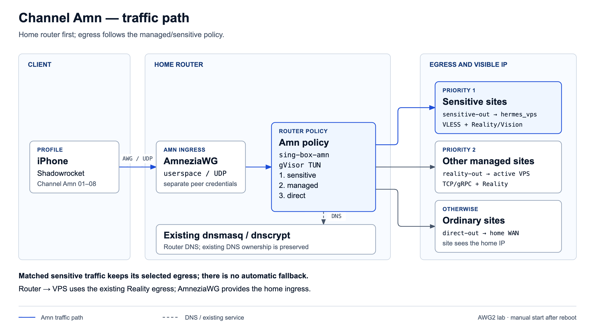
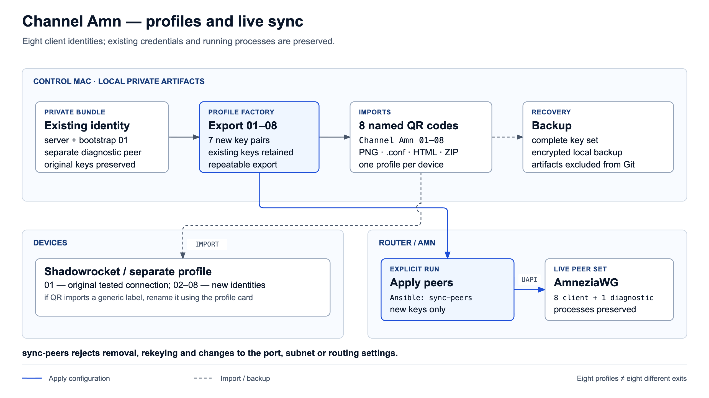
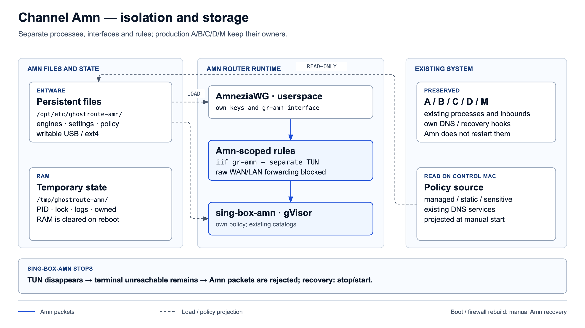

# Channel Amn: home-first AmneziaWG lab

Status: opt-in home-first compatibility lab implemented and live-verified on
2026-11-04; not a production channel. Shadowrocket 2.2.93 was operator-tested on
iPhone over mobile data with web access and Telegram photos. This establishes
the tested AWG 2 wire profile only, not AWG 3.1 interoperability.

The editable diagram pages ([English](../../../docs/assets/diagrams/channel-amn-architecture-en.html),
[Русский](../../../docs/assets/diagrams/channel-amn-architecture.html)) contain the
three PNG figures embedded below in both languages, with the repository's visual
conventions and public role-only labels.

## Meaning and recommendation

An additional server entry in Shadowrocket means a selectable connection profile,
not additional hardware. Amn must terminate on the existing home router, with the
existing VPS providing managed egress. Direct client-to-VPS placement does not
meet the selected topology.

Use a separate AmneziaWG ingress on the router and a manually selected Amn entry
in Shadowrocket. Existing A/B/C/D/M services and client imports must remain
unchanged. This is coexistence of services, not automatic failover or a promise
of two simultaneous iOS VPNs.



AmneziaWG applies only to the client-to-router leg. Managed router-to-VPS traffic
continues to use VLESS + Reality/Vision; an Amnezia server on the VPS is unnecessary.
The mobile network sees the home endpoint as the tunnel destination. The VPS is
the exit for matched managed traffic. Non-managed traffic retains home-WAN egress
under the existing split policy; selected full-VPS mode for Channel A is not
implicitly extended to Amn.

As with other channels, client DIRECT rules can bypass the router. A proof
profile must send tested traffic and DNS through Amn. This design preserves the
[home-first contract](../../../docs/routing-policy-principles.md), not a universal
guarantee that every iPhone connection or DNS bootstrap uses the tunnel.

## Protocol and client compatibility

AmneziaVPN is a multiprotocol application. AmneziaWG is the UDP-based protocol
considered here; choosing Amnezia's Xray option would not provide the same
transport diversity from the existing VLESS/Reality paths.

The official Shadowrocket App Store history records AmneziaWG changes, including
Junk Manager work in 2.2.78, junk-key parsing fixes in 2.2.82 and magic-header
fixes in 2.2.90. This establishes AmneziaWG functionality in the client lineage,
but does not establish interoperability of the installed 2.2.93 with every
AmneziaWG generation or configuration parameter.

Official Amnezia documentation describes 3.1 as the current generation and
recommends migration from outdated 2.0. Prefer 3.1 as the target. Compatibility
with Shadowrocket remains unproven until a matching configuration completes a
handshake and transfers real traffic. Do not silently downgrade to 2.0 or disable
obfuscation to present ordinary WireGuard as a successful AmneziaWG test. An
older-generation test, if needed, is a separately labelled compatibility lab.

The first implementation explicitly uses an AWG 2 compatibility wire profile on
the pinned 3.1 userspace engine. Header protection and other AWG 3-only features
are not claimed. This is a transport/integration test for Shadowrocket, not a
production recommendation to downgrade AmneziaWG.

## First lab operation

Build with `bash modules/routing-core/bin/build-channel-amn`. The upstream revision
is pinned in that script; source, binaries and credentials remain under the
gitignored `ansible/out/channel-amn/`. The diagnostic client uses an in-process
network stack and does not install routes or a system VPN on the control Mac.

Generate new credentials with `channel-amn-profile <private-options.json>
ansible/out/channel-amn`. The private options contain the home endpoint, an unused
UDP port, unused private peer subnet and routing identifiers. The generator
refuses to overwrite an existing identity and creates distinct iPhone/probe peers.
It requires the control Python's `cryptography` package.

## Eight named client profiles

The public channel name is **Channel Amn**. Its client slots are **Channel Amn
01** through **Channel Amn 08**, each intended for one device. They are eight
identities on the same ingress and routing policy, not eight separate channels
or exit addresses. A ninth, separate peer is reserved for diagnostics.



Export an existing working bundle without changing its server identity:

```bash
./modules/routing-core/bin/channel-amn-profile --export-eight ansible/out/channel-amn
```

This requires local `qrencode`. It creates `clients/index.html`, eight named PNG
QR codes, eight `.conf` imports and `Channel-Amn-8-profiles.private.zip`. Client
metadata, keys, server settings and all exports stay under ignored
`ansible/out/channel-amn/`. The operator archive excludes the server
private key and the diagnostic client. The archive still contains all eight
client credentials and must remain private.

Channel Amn 01 preserves the already tested bootstrap client's key, address and
PSK. Its existing import remains valid; rename it in the client instead of
importing the same identity twice on that device. Use 02–08 for additional
devices. File names and QR cards carry the stable names; if Shadowrocket assigns
a generic label after scanning, rename that new entry to the matching card name.

Export is repeatable: saved client keys are reused. Missing credentials for an
already allocated slot cause an error and require restoring the local backup;
the generator does not silently rotate them. QR rendering finishes before the
new settings are published. Keep a private backup of the complete bundle.

After the local tests below, add the seven new peers to the running lab:

```bash
cd ansible
ansible-playbook playbooks/28-channel-amn-lab.yml -e channel_amn_action=sync-peers
```

This action preserves both Amn processes and all existing peers. It verifies the
live server identity/transport and existing peer keys/AllowedIPs, then adds only
missing peers through the engine's control socket. It rejects changes to an
existing identity, port, subnet or routing settings. Repeating it is idempotent.
A failed addition removes only the newly attempted keys and restores prior
settings. Removal/rekeying is outside this additive operation.

Eight configured client slots do not establish capacity for eight simultaneous
heavy transfers. The lab resource gate and real-client checks still apply.

The batch acceptance pass decoded all eight PNG payloads back to the exact
matching `.conf` bytes, checked the local index in desktop/mobile layouts and
verified the seven new identities with real encrypted requests. A new identity
also passed an external-to-home test with both sensitive VPS and ordinary
home-WAN exits. Existing peer identities and both Amn process IDs were preserved.

## Local checks and explicit deployment

Run `bash tests/test-channel-amn.sh`, `bash tests/test-sensitive-sites.sh` and the
Ansible syntax check before deployment. Run the repository secret scan after
generating local credential material; the entire Amn output directory is ignored.
Amn fixtures are included in `tests/run-fast.sh`; CI installs their Python
dependencies explicitly.

```bash
cd ansible
ansible-playbook --syntax-check playbooks/28-channel-amn-lab.yml
ansible-playbook playbooks/28-channel-amn-lab.yml -e channel_amn_action=start
ansible-playbook playbooks/28-channel-amn-lab.yml -e channel_amn_action=status
ansible-playbook playbooks/28-channel-amn-lab.yml -e channel_amn_action=stop
```

The default action is status. Start fetches the current production configuration,
projects the selected-client policy, validates its source hash and installs only
Amn files. Stop first closes its UDP ingress and then removes its processes,
interfaces, table and chains. A repeat start requires stopping the current lab.
Existing listeners and imported profiles are not regenerated.

The lab runs all routing/VPS deploy-critical health checks before and after start.
Only warnings about the separate Console collector transport are non-blocking
for this playbook; other warnings and every critical failure still stop the lab.
The general platform deploy gate is unchanged.

Post-start acceptance must also verify that the policy TUN is UP, both Amn
processes run and the LAN managed egress guard remains first in FORWARD. The
controller currently waits for TUN existence before route-add; a TUN-before-UP
race can reject startup. Amn's inserted FORWARD rules can also displace the LAN
guard. Keep failed startup contained, inspect the owned error and use the
documented `guard-only` recovery after reviewing ordering; do not bypass preflight
or flush shared chains. Durable readiness/order fixes remain tracked under
[RA-09](../../../docs/routing-assurance-roadmap.md#ra-04ra-06--плановое-укрепление-эксплуатации).

This first lab has no boot hook/watchdog and deliberately does not modify
`services-start`, `firewall-start` or existing supervisors. Reboot ends the lab;
after a router firewall rebuild, stop/start Amn before further testing. A policy
change also requires stop/start to regenerate the isolated projection. Promotion
requires proving automatic reconciliation separately. The first peer is IPv4;
IPv6 and payload UDP/443 are rejected within Amn only. Router/LAN management
access through the new peer is blocked; DNS is the explicit loopback exception.

The first live acceptance pass proved external ingress to home, sensitive VPS
identity, non-managed home-WAN identity, a multi-packet HTTPS asset download and
the operator's iPhone test. Deliberately stopping the Amn policy process removed
its TUN, left the terminal unreachable route and made the external request fail;
an explicit Amn-only restart restored successful requests. Production config,
process identity, protected firewall rules and the main default route remained
unchanged. Raw evidence and real endpoints stay in ignored local reports.

An unauthenticated scripted request to an AI service can receive an HTTP challenge
or rejection; this is not proof of a broken tunnel or of a working signed-in
session. Keep the real-client acceptance test separate from network canaries.

## Router integration design



AmneziaWG terminates into an IP interface; it does not itself implement the
GhostRoute domain split. Adding only a tunnel and a WAN masquerade rule would
skip that policy. Likewise, the current sing-box template scopes mobile and
sensitive rules to named inbounds: a new tag does not inherit them automatically.

The preferred isolation design is two separately managed processes: a pinned
userspace AmneziaWG engine and an Amn-only sing-box packet/policy frontend. The
frontend has its own TUN and configuration, so bringing up the experiment does
not require restarting or changing the production sing-box instance.
It runs a private copy of the proven binary named `sing-box-amn`, keeping the
production init script's `pidof`/`killall sing-box` ownership separate.
The first lab uses the gVisor TUN stack, avoiding native-stack TCP bridging into
the router's local INPUT firewall. Its extra CPU/memory cost is part of the lab's
resource gate; no additional router-local TCP accept rule is introduced.

- Give Amn its own peer subnet, keys, unused UDP listener, interface, routing
  table and firewall chains. Peer AllowedIPs on the server must be limited to
  assigned peer addresses, not a default route.
- Keep sing-box `auto_route` and `auto_redirect` off. Route only packets arriving
  on the Amn interface into its policy TUN using explicit interface-scoped rules.
  Preserve router OUTPUT, the main default route and all existing channel rules.
  Use fields supported by the installed binary, not unverified latest-doc options.
- Block raw Amn forwarding to WAN/LAN outside that frontend and explicitly
  restrict access to router-local services. A terminal unreachable route/guard
  must prevent a missing TUN or process from falling through to the main WAN
  table. This is failure containment for Amn, not a global router kill switch.
- Derive Amn policy from the same managed/static catalogs, sensitive list,
  direct exceptions and backend settings. Read shared rule sets without taking
  their ownership; refresh only the Amn configuration when required. Verify
  equivalent decisions with fixtures rather than maintain a divergent manual
  copy or rely on inherited inbound tags. Channel M remains excluded.
- Send Amn client DNS through the tunnel to a restricted Amn-facing path that
  uses existing router dnsmasq/dnscrypt policy. Do not change router DNS ownership
  or expose an unauthenticated public resolver. Test both TCP and UDP DNS.
- Account for IP-only packet ingress: preserve HTTP/TLS hostname detection and
  sensitive-before-managed ordering. Managed destination IP matching and payload
  QUIC handling need explicit tests. Outer AmneziaWG UDP must remain distinct
  from managed payload UDP/443 filtering. Hidden hostnames, ECH and client
  bypasses retain the [sensitive-mode limitations](sensitive-sites-mode.md).
- Prove return routes, DNS and IPv6 containment before promotion. If IPv6 is not
  supported in the first experiment, reject it on Amn and verify the test client
  does not send it outside the tunnel; do not change global IPv6 settings.

The existing ARM64 router has userspace TUN support, but this is not a throughput
proof. It lacks a memory cgroup controller, so VPS-style hard memory isolation
cannot be assumed. Start with one selected test client, bounded logs and measured
CPU/RAM headroom. Shared hardware cannot promise zero performance impact.
Deployment-specific capability evidence stays in ignored local reports.

The reviewed Merlin addon supports userspace operation but also manages DNS
interception and policy routing. Installing the whole addon would overlap
GhostRoute ownership. Use a narrowly owned integration; never reactivate legacy
WireGuard lanes, run a global route setup helper or replace existing firewall
hooks with the addon's policies.

## Implementation and rollback boundaries

The opt-in Ansible playbook installs router runtime files from the Routing Core
module. Binaries, `settings.json`, `policy.json`, its source hash and the controller
persist under `/opt/etc/ghostroute-amn/` on writable Entware storage. PID files,
the lock, logs and the active ownership snapshot live under
`/tmp/ghostroute-amn/` in RAM. The private control-Mac bundle holds the server
identity and every recoverable client key as well as the generated imports.

Start validates policy inputs and resource ownership before opening ingress.
The current lab has no boot or firewall-rebuild reconciliation. Automatic
startup/reconciliation is a future promotion gate and must restore only
Amn-owned rules, while containing Amn traffic during startup and failure.
Existing A/B/C/D/M recovery ownership stays intact.

Store real endpoints and keys in Vault or ignored local files; new Amn profiles
are local credential material. There is no migration of existing client imports.
No additional VPS service, public VPS listener or new hardware is needed for
this design. A new authenticated UDP listener is required on the home router.

Rollback closes Amn ingress, stops only Amn processes, and removes only its
owned rules/interfaces after peer traffic is contained. A failed Amn experiment
must leave the existing channels available. Deployment follows local checks and
the repository's authorization rules; the topology choice is already settled.

## Acceptance gates

1. Establish a matching Shadowrocket/server generation, pinned router binary and
   configuration syntax before opening the new listener.
2. Verify import preserves obfuscation parameters, then prove handshake and real
   TCP/UDP transfer; a connected badge is insufficient.
3. Prove the first hop is home. Test managed-domain and raw static-CIDR routes,
   direct exceptions and non-managed home-WAN egress, sensitive priority and no
   backend fallback, DNS and IPv6 containment. Include hostname-hidden cases
   rather than claiming a universal single-IP guarantee.
4. Exercise mobile/Wi-Fi roaming, Telegram media, AI services and MTU-sensitive
   transfers. UDP blocking can still prevent Amn from working.
5. Compare A/B/C/D/M listeners, rules, DNS and representative traffic before and
   after; measure shared CPU/memory load. Verify Amn-only process failure,
   firewall rebuild, startup ordering and isolated rollback before a controlled
   reboot test.

## Sources

- [Shadowrocket official release history](https://apps.apple.com/us/app/shadowrocket/id932747118)
- [AmneziaWG protocol generations](https://docs.amnezia.org/documentation/amnezia-wg/)
- [Amnezia FAQ and migration guidance](https://docs.amnezia.org/faq/)
- [Official userspace implementation](https://github.com/amnezia-vpn/amneziawg-go)
- [sing-box TUN settings and automatic routing behavior](https://sing-box.sagernet.org/configuration/inbound/tun/)
- [Merlin addon maintainer documentation](https://github.com/william-aqn/asuswrt-merlin-amneziawg/blob/main/README_EN.md)
