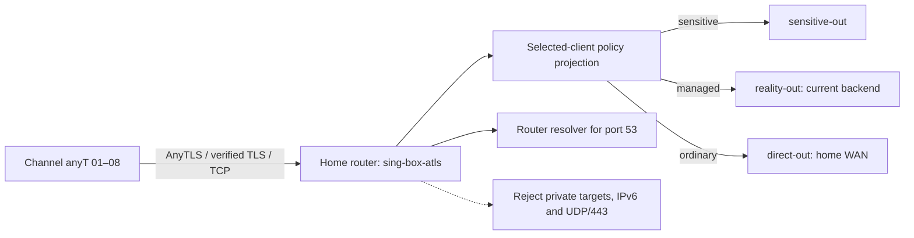
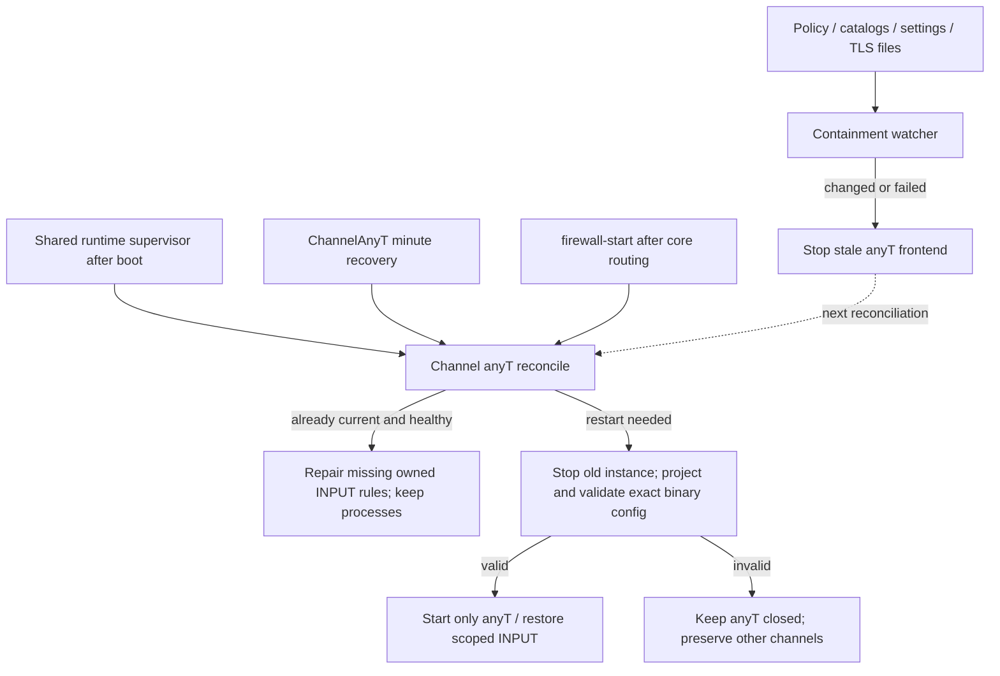

# Channel anyT — home-first AnyTLS

Channel anyT is a production selected-client channel on the home
router. It terminates AnyTLS over verified TLS/TCP, then applies the existing
sensitive / managed / direct policy in a separate sing-box process. It has eight
independent client identities and a separate diagnostic identity. Existing
A/B/C/D/M ownership and imported profiles are preserved.

The filename and internal `ghostroute-anytls`, `sing-box-atls` and `lab-client`
identifiers are retained for compatibility. The operator-facing name is
**Channel anyT**. The original first and second QR codes remain usable.

[Platform routing and lifecycle images](../../../docs/assets/diagrams/ghostroute-platform-en.html)
· [Русские схемы](../../../docs/assets/diagrams/ghostroute-platform-ru.html)
· [Engineering review and remaining gates](../../../docs/routing-assurance-roadmap.md#ra-13--channel-anyt-проверки-обслуживания).





## Configuration and protocol choices

Use the proven router Entware sing-box baseline under a separate process name.
AnyTLS inbound support starts at 1.12.0; candidate binary upgrades still require
the compatibility gate. Newer documentation may describe unsupported fields.
Validate every configuration against the exact installed binary.

TLS validates the home server's name and public certificate. Certificate renewal
remains owned by the existing router TLS service; anyT observes renewed files
and restarts itself. No insecure certificate bypass, separate ACME owner,
unverified fingerprint override or Reality wrapper is used.

Keep the currently interoperable default padding scheme. Upstream describes
its default as an example, not a filtering guarantee. Random padding changes
are not a demonstrated improvement. AnyTLS already implements session reuse;
client pool tuning requires actual measurements. The router is the AnyTLS
server: a sing-box outbound metadata option does not configure Shadowrocket.
Use sing-box's maintained integration rather than the reference demo's insecure
defaults. A successful alternative transport/port does not establish DPI as the
cause of another channel's failure.

## Routing and DNS

The projector copies the `channel-b-relay-socks` reference scope's ordered rules
and outbounds into its own inbound. This is a configuration dependency, not a
packet relay through Channel B; the B process is not required for anyT traffic.
Unsupported unscoped, logical, user-scoped or egress-dependent changes
reject projection. It never borrows another channel's relay or changes production
DNS, router OUTPUT, LAN REDIRECT/FORWARD, TUN or default-route ownership.
Individual Channel A full-VPS overrides are not inherited automatically.

Sensitive destinations retain their dedicated egress with no direct fallback.
Managed targets use the active managed backend; ordinary targets use home WAN.
Private/local and IPv6 targets are rejected. TCP/UDP port 53 is forced to the
router resolver before private-address rejection. Payload UDP/443 is rejected
to encourage TCP fallback. Other UDP uses AnyTLS UDP-over-TCP and the same route
policy. Protocol support is not proof of successful voice/video calls.

Import QR/URI nodes under Shadowrocket **Home** and `Channel-anyT.conf` under
**Config**. The config uses `FINAL,PROXY`, disables IPv6, routes DNS through the
proxy and avoids system-DNS fallback. The shipped configuration names DoH resolvers:
those HTTPS requests are not port-53 queries and therefore are not rewritten by
the router's port-53 override. Check actual client DNS behavior separately.
Choose a Channel anyT node as active;
importing it alone does not select it. Global Routing → Proxy is the diagnostic
control. Client DIRECT rules, app-owned DNS/ECH and client bypasses retain the
platform's documented assurance limits.

## Eight private client imports

### Protected issued profiles

**Channel anyT 01–08 are the operator-approved production set for real clients.**
All eight issued imports, plus the original first/second imports, must remain
valid during future work. Routine maintenance does not regenerate, overwrite,
remove or rotate them. Preserve the endpoint, transport, TLS server name and
validation, credentials and issued URI payload. Restore lost files from the
verified encrypted backup; creating a new bundle is not recovery.

The [repository production contract](../../../AGENTS.md#channel-anyt-protected-production-contract)
applies to shared routing, DNS, firewall, TLS, storage, supervisor and package
changes too. Check anyT before and after relevant changes: enabled marker/cron,
owned processes, current policy, an authenticated application request and unchanged
issued imports. Plan explicit operator-approved interruptions and compatible
rollback. Do not leave anyT disabled after unrelated work or weaken fail-closed
policy to restore availability. Breaking migrations require separate approval
and preferably a parallel path for existing clients.

Only symbolic client slots and acceptance rules are tracked. The ignored bundle
contains `production-approval.private.json` with the approved settings/artifact
fingerprints; retain it with the encrypted backup. `--verify-approved BUNDLE`
verifies the complete required artifact set and canonical settings without writing.
`--settings captured.json` additionally verifies captured router settings. The
production playbook runs this before mutation; the shared deployment gate also
compares live settings with approval. Missing/incomplete approval, missing files
or mismatches fail the check. This does not replace real-client acceptance.

```bash
# New bundle only; never overwrite an existing identity.
python3 modules/routing-core/bin/channel-anytls-profile \
  configs/private/anytls-options.json ansible/out/channel-anytls
# Explicitly approved initial allocation only, not routine maintenance/recovery.
python3 modules/routing-core/bin/channel-anytls-profile \
  --export-eight ansible/out/channel-anytls
```

Private options: `host`, `port`, `server_name`, `certificate_path`, `key_path`.
Use an unused high TCP port and a valid certificate covering the home endpoint.
Public examples use `home.example.invalid`, `<anyt-port>` and placeholder paths.
The generator requires local `qrencode`.

Exports are in ignored `ansible/out/channel-anytls/clients/`:

- `Channel-anyT-01.png/.uri` through `Channel-anyT-08.png/.uri`.
- `qr-index.html`: responsive, printable eight-card index.
- `Channel-anyT.conf`: shared Shadowrocket policy configuration.

`Channel-anyT-8-profiles.private.zip` contains client artifacts only, excluding
server settings, production policy and the diagnostic password. It is still
sensitive credential material. The first two slots reuse their original
passwords. Once the approval manifest exists, `--export-eight` and `--add-second`
refuse before writing, including when verification fails. Unapproved bootstrap
exports preserve allocated identities but can rewrite artifact files. Production
maintenance uses the saved files. The deployment gate verifies approval as well
as compatibility with existing router settings.
Restore the complete private bundle if credentials are missing. One identity is
intended for one device; eight imports
do not establish eight simultaneous heavy-stream capacity. Back up the complete
bundle separately from the client-only ZIP. The old `--add-second` command remains
available for an initial one-client bundle.

## Deployment and automatic recovery

The existing playbook filename is retained:

```bash
bash tests/test-channel-anytls.sh
cd ansible
ansible-playbook --syntax-check playbooks/31-channel-anytls-lab.yml
# Read-only status; no installation or restart.
ansible-playbook playbooks/31-channel-anytls-lab.yml
```

The following actions mutate the router. `enable` and `disable` interrupt this
production channel and require an explicitly approved maintenance window under
the protected contract, beyond general deployment permission:

```bash
# From ansible/; only the approved action, not all three in sequence.
ansible-playbook playbooks/31-channel-anytls-lab.yml -e channel_anytls_action=enable
ansible-playbook playbooks/31-channel-anytls-lab.yml -e channel_anytls_action=reconcile
ansible-playbook playbooks/31-channel-anytls-lab.yml -e channel_anytls_action=disable
```

Status is the default. Playbook `enable` reinstalls the service/projector and
boot/firewall integration, restarts anyT, writes the persistent `enabled` marker and registers
`ChannelAnyT` minute recovery. `disable` removes the marker/cron and closes only
anyT, retaining its keys, configuration and exports. Legacy `start/stop` remain
for diagnostics; `stop` is temporary while recovery is enabled. Use `disable`
for a persistent operator stop. `reconcile` does nothing when the persistent
enabled marker is absent; when already healthy it repairs only missing owned
firewall state. It is not a profile generator.

Persistent files: `/opt/etc/ghostroute-anytls/`. Volatile state:
`/tmp/ghostroute-anytls/`. Only a TCP-port-scoped INPUT jump and `GR_ATLS_IN`
chain are owned. Locks serialize boot, cron and firewall reconciliation. Startup
checks policy, exact binary syntax, memory and resource ownership. Address reuse
permits restart after TCP TIME_WAIT while rejecting an occupied active listener.

Boot recovery follows core service preparation. Firewall recovery restores only
missing anyT rules, preserving healthy process identities. Process loss triggers
a scoped restart. Once detected, policy, settings, catalog-content and TLS-file
changes stop stale traffic before validated regeneration. Identical catalog
rewrites do not restart the channel. Invalid input keeps anyT closed; there is no
backend fallback or restart of other channel processes.

The watcher checks every two seconds; recovery runs on the next reconciliation,
normally within the minute. This is bounded polling, not atomic or zero-downtime
reconciliation. Unsupported policy or missing storage requires operator repair.
Go memory targets are soft limits, not cgroups. Logs have a containment/restart
threshold. Existing production recovery stays independent of anyT failures.

Unexpected contents in the owned firewall chain stop reconciliation with an
error for review; only missing known rules are repaired automatically. A running
listener is not a continuous authenticated application-health check, and this
controller does not switch egresses when a remote service fails.

### Reading status correctly

| Field | What it establishes | What still needs a separate check |
|---|---|---|
| `policy_running`, `watch_running` | Matching owned processes exist | TLS, authentication, firewall admission and real application transfer |
| `source_current` | Main sing-box JSON matches the saved projection source hash | All catalog/TLS/settings signatures, reachability and route outcomes |
| `boot_persistent` | The persistent `enabled` marker exists | Installed boot/firewall hooks and the actual `ChannelAnyT` cron entry |
| `clients_configured` | Number of configured non-probe identities | Active sessions, issued-file hashes and acceptance of each identity |
| `contained` | A containment marker exists | Current root cause; inspect private operation/watch evidence |

## Maintenance acceptance checklist

Run `bash modules/ghostroute-health-monitor/bin/channel-anyt-check` from the control
checkout. It verifies local approval, live settings, enabled state, owned
processes, source hash, cron/hook presence, exact scoped INPUT admission rules and
an authenticated HTTPS request through the existing anyT listener using the probe
identity. It creates only temporary private loopback probe files/processes and
cleans them up; it does not restart anyT or change routing/firewall.

`deploy.sh` and the shared Ansible `deploy-gate.yml` invoke it before/after their
normal deployments. The anyT playbook verifies approval before any mutation and
checks the existing service before update and the enabled service afterwards.
Unprovisioned environments pass only when both server settings and the local
bundle are absent; missing server state with a local identity fails. The existing
explicit emergency skip applies to the shared gate. Direct playbooks that do not
include that shared task still require this command explicitly.

This proves loopback admission and one HTTPS destination; external ingress,
all-client authentication, route parity and mobile acceptance remain distinct.
Failure blocks deployment completion but does not automatically roll back an
already applied shared change. The existing anyT rescue behavior remains below.

Apply this to anyT updates and shared routing, catalog, DNS, TLS, firewall,
storage, supervisor or package maintenance that could affect it.

1. **Before:** read status, verify the enabled marker/cron/hooks, own processes
   and scoped INPUT rules, then make an authenticated application request using
   the diagnostic identity. Save the baseline and reviewed rollback privately.
2. **Preserve imports:** compare all eight issued PNG/URI files, shared Config,
   original first/second imports and canonical settings with
   `production-approval.private.json`. Do not publish hashes or replace the
   manifest with new values merely to clear a mismatch. If settings on the router
   are absent, establish identity from the verified backup before any installation.
3. **Local gate:** run `bash tests/test-channel-anytls.sh`; for runtime changes also
   validate the candidate policy with the exact target binary. Hook changes need
   shared supervisor/firewall fixtures. Do not execute a broad mutating playbook
   just to update documentation.
4. **After an approved change:** repeat the baseline checks, authenticate all
   eight preserved identities, and verify sensitive / managed / direct behavior.
   Ask for real-client messages/media after relevant transport or lifecycle work;
   server probes alone do not establish client behavior. Keep other channels healthy.
5. **Failure:** the playbook's rescue path disables anyT after a failed mutation;
   it does not restore the previous version automatically. Restore the reviewed
   controller/settings/policy using the existing approved maintenance scope,
   enable and recheck it, or explicitly report the unresolved outage. Never leave
   a failed update described as complete or weaken TLS/routing guards to pass it.

Keep server settings, the probe credential, issued artifacts and approval manifest
with the encrypted recovery bundle, alongside controller/projector, compatible
binary, TLS dependencies and shared hooks. The client-only ZIP is not a server
backup. An independent copy is verified only after a complete download, hash
comparison and authenticated decryption/read; local verification alone does not
establish offsite recovery.

## Verification and rollback

Local tests cover policy parity, guards, eight-client export, preserved identities,
rekey rejection, QR failure, port reuse, input signatures, cold volatile state and
scoped reconciliation. Run shared supervisor/firewall fixtures for hook changes.
The [test/evidence matrix](../../../docs/testing.md#channel-anyt-verification)
distinguishes fixtures, router checks and client acceptance. Existing general
platform health checks alone do not authenticate anyT; the added anyT gate does.

Verify TLS/name/auth rejection, TCP/UDP DNS, managed/sensitive/direct selection,
private/IPv6 rejection and each authenticated client. Exercise process death,
scoped firewall loss, input drift and boot recovery. Compare production config,
processes, routing and decision rules; account separately for dynamic counters
and accounting-only RETURN entries.

Operator acceptance has established Telegram messages/photos on a mobile client.
Other carriers, configured DNS behavior, idle/roaming, calls and sustained capacity
require separate client acceptance. Server bootstrap success is not signed-in
messaging proof. Raw evidence and backups remain private.

Rollback: `disable`, restore the previous private bundle/controller from encrypted
backup, then deploy only the reviewed version. Restore shared hook backups only
if necessary and verify core routing. Existing imports remain valid because the
listener and credentials are preserved.

## Primary references

- [sing-box AnyTLS inbound](https://sing-box.sagernet.org/configuration/inbound/anytls/)
- [AnyTLS protocol](https://github.com/anytls/anytls-go/blob/main/docs/protocol.md)
- [AnyTLS FAQ: padding and limits](https://github.com/anytls/anytls-go/blob/main/docs/faq.md)
- [AnyTLS URI format](https://github.com/anytls/anytls-go/blob/main/docs/uri_scheme.md)
- [sing-box TLS](https://sing-box.sagernet.org/configuration/shared/tls/)
- [Client metadata/version boundaries](https://sing-box.sagernet.org/manual/misc/anytls-client-metadata/)
