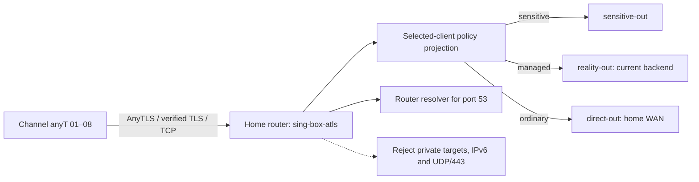
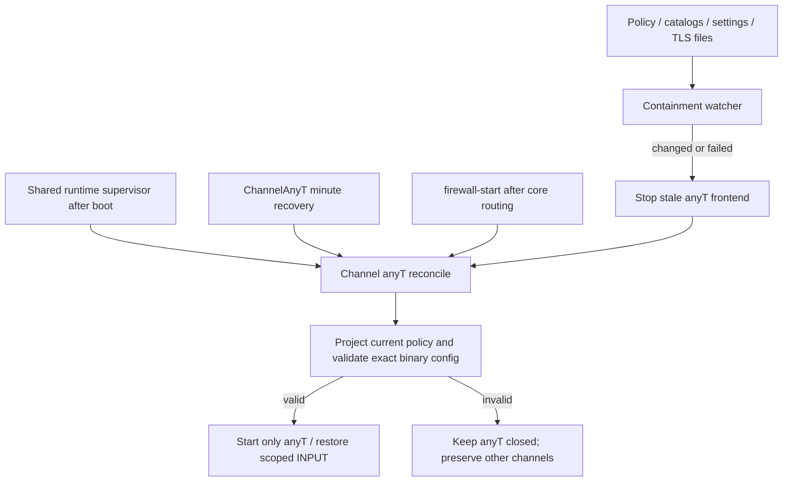

# Channel anyT — home-first AnyTLS

Channel anyT is an additional working selected-client channel on the home
router. It terminates AnyTLS over verified TLS/TCP, then applies the existing
sensitive / managed / direct policy in a separate sing-box process. It has eight
independent client identities and a separate diagnostic identity. Existing
A/B/C/D/M ownership and imported profiles are preserved.

The filename and internal `ghostroute-anytls`, `sing-box-atls` and `lab-client`
identifiers are retained for compatibility. The operator-facing name is
**Channel anyT**. The original first and second QR codes remain usable.





## Configuration and protocol choices

Use the proven router Entware sing-box baseline under a separate process name.
AnyTLS inbound support starts at 1.12.0; candidate binary upgrades still require
the compatibility gate. Newer documentation may describe unsupported fields.
Validate every configuration against the exact installed binary.

TLS validates the home server's name and public certificate. Certificate renewal
remains owned by the existing router TLS service; anyT observes renewed files
and restarts itself. No insecure certificate bypass, separate ACME owner,
unverified fingerprint override or Reality wrapper is used.

Keep the currently interoperable default padding scheme. Upstream describes
its default as an example, not a filtering guarantee. Random padding changes
are not a demonstrated improvement. AnyTLS already implements session reuse;
client pool tuning requires actual measurements. The router is the AnyTLS
server: a sing-box outbound metadata option does not configure Shadowrocket.
Use sing-box's maintained integration rather than the reference demo's insecure
defaults. A successful alternative transport/port does not establish DPI as the
cause of another channel's failure.

## Routing and DNS

The projector copies the existing selected-client scope's ordered rules and
outbounds. Unsupported unscoped, logical, user-scoped or egress-dependent changes
reject projection. It never borrows another channel's relay or changes production
DNS, router OUTPUT, LAN REDIRECT/FORWARD, TUN or default-route ownership.
Individual Channel A full-VPS overrides are not inherited automatically.

Sensitive destinations retain their dedicated egress with no direct fallback.
Managed targets use the active managed backend; ordinary targets use home WAN.
Private/local and IPv6 targets are rejected. TCP/UDP port 53 is forced to the
router resolver before private-address rejection. Payload UDP/443 is rejected
to encourage TCP fallback. Other UDP uses AnyTLS UDP-over-TCP and the same route
policy. Protocol support is not proof of successful voice/video calls.

Import QR/URI nodes under Shadowrocket **Home** and `Channel-anyT.conf` under
**Config**. The config uses `FINAL,PROXY`, disables IPv6, routes DNS through the
proxy and avoids system-DNS fallback. Choose a Channel anyT node as active;
importing it alone does not select it. Global Routing → Proxy is the diagnostic
control. Client DIRECT rules, app-owned DNS/ECH and client bypasses retain the
platform's documented assurance limits.

## Eight private client imports

```bash
# New bundle only; never overwrite an existing identity.
python3 modules/routing-core/bin/channel-anytls-profile \
  configs/private/anytls-options.json ansible/out/channel-anytls
# Existing bundle: preserve every already allocated identity.
python3 modules/routing-core/bin/channel-anytls-profile \
  --export-eight ansible/out/channel-anytls
```

Private options: `host`, `port`, `server_name`, `certificate_path`, `key_path`.
Use an unused high TCP port and a valid certificate covering the home endpoint.
Public examples use `home.example.invalid`, `<anyt-port>` and placeholder paths.
The generator requires local `qrencode`.

Exports are in ignored `ansible/out/channel-anytls/clients/`:

- `Channel-anyT-01.png/.uri` through `Channel-anyT-08.png/.uri`.
- `qr-index.html`: responsive, printable eight-card index.
- `Channel-anyT.conf`: shared Shadowrocket policy configuration.

`Channel-anyT-8-profiles.private.zip` contains client artifacts only, excluding
server settings, production policy and the diagnostic password. It is still
sensitive credential material. The first two slots reuse their original
passwords. Repeat export reuses saved identities; the deployment gate refuses
removal/rekeying or ingress changes. Restore the complete private bundle if
credentials are missing. One identity is intended for one device; eight imports
do not establish eight simultaneous heavy-stream capacity. Back up the complete
bundle separately from the client-only ZIP. The old `--add-second` command remains
available for an initial one-client bundle.

## Deployment and automatic recovery

The existing playbook filename is retained:

```bash
bash tests/test-channel-anytls.sh
cd ansible
ansible-playbook --syntax-check playbooks/31-channel-anytls-lab.yml
ansible-playbook playbooks/31-channel-anytls-lab.yml -e channel_anytls_action=enable
ansible-playbook playbooks/31-channel-anytls-lab.yml
ansible-playbook playbooks/31-channel-anytls-lab.yml -e channel_anytls_action=reconcile
ansible-playbook playbooks/31-channel-anytls-lab.yml -e channel_anytls_action=disable
```

Status is the default. `enable` installs the isolated service/projector and
boot/firewall integration, writes the persistent `enabled` marker and registers
`ChannelAnyT` minute recovery. `disable` removes the marker/cron and closes only
anyT, retaining its keys, configuration and exports. Legacy `start/stop` remain
for diagnostics; `stop` is temporary while recovery is enabled. Use `disable`
for a persistent operator stop.

Persistent files: `/opt/etc/ghostroute-anytls/`. Volatile state:
`/tmp/ghostroute-anytls/`. Only a TCP-port-scoped INPUT jump and `GR_ATLS_IN`
chain are owned. Locks serialize boot, cron and firewall reconciliation. Startup
checks policy, exact binary syntax, memory and resource ownership. Address reuse
permits restart after TCP TIME_WAIT while rejecting an occupied active listener.

Boot recovery follows core service preparation. Firewall recovery restores only
missing anyT rules, preserving healthy process identities. Process loss triggers
a scoped restart. Policy, settings, catalog-content and TLS-file changes stop
stale traffic before validated regeneration. Identical catalog rewrites do not
restart the channel. Invalid input keeps anyT closed; there is no backend fallback
or production service restart.

The watcher checks every two seconds; recovery runs on the next reconciliation,
normally within the minute. This is bounded polling, not atomic or zero-downtime
reconciliation. Unsupported policy or missing storage requires operator repair.
Go memory targets are soft limits, not cgroups. Logs have a containment/restart
threshold. Existing production recovery stays independent of anyT failures.

## Verification and rollback

Local tests cover policy parity, guards, eight-client export, preserved identities,
rekey rejection, QR failure, port reuse, input signatures, cold volatile state and
scoped reconciliation. Run shared supervisor/firewall fixtures for hook changes.

Verify TLS/name/auth rejection, TCP/UDP DNS, managed/sensitive/direct selection,
private/IPv6 rejection and each authenticated client. Exercise process death,
scoped firewall loss, input drift and boot recovery. Compare production config,
processes, routing and decision rules; account separately for dynamic counters
and accounting-only RETURN entries.

Operator acceptance has established Telegram messages/photos on a mobile client.
Other carriers, configured DNS behavior, idle/roaming, calls and sustained capacity
require separate client acceptance. Server bootstrap success is not signed-in
messaging proof. Raw evidence and backups remain private.

Rollback: `disable`, restore the previous private bundle/controller from encrypted
backup, then deploy only the reviewed version. Restore shared hook backups only
if necessary and verify core routing. Existing imports remain valid because the
listener and credentials are preserved.

## Primary references

- [sing-box AnyTLS inbound](https://sing-box.sagernet.org/configuration/inbound/anytls/)
- [AnyTLS protocol](https://github.com/anytls/anytls-go/blob/main/docs/protocol.md)
- [AnyTLS FAQ: padding and limits](https://github.com/anytls/anytls-go/blob/main/docs/faq.md)
- [AnyTLS URI format](https://github.com/anytls/anytls-go/blob/main/docs/uri_scheme.md)
- [sing-box TLS](https://sing-box.sagernet.org/configuration/shared/tls/)
- [Client metadata/version boundaries](https://sing-box.sagernet.org/manual/misc/anytls-client-metadata/)
