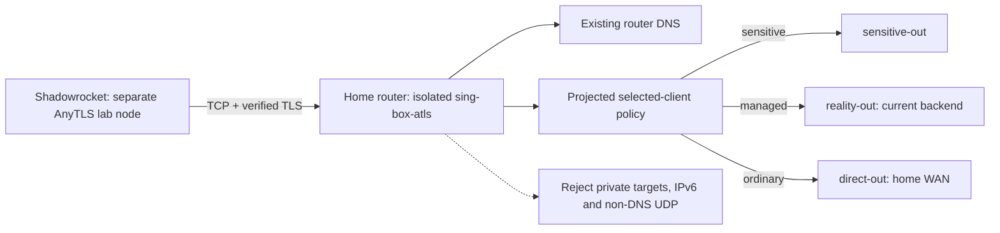

# AnyTLS home-first compatibility lab

An additive, manually operated TCP/TLS ingress for up to two selected test clients.
It compares an alternative to the existing Reality/Vision first hop without
changing the managed egress or existing A/B/C/D/M/Amn client imports. A working
lab does not prove that DPI caused a failure on another transport.



## Scope and compatibility

AnyTLS is supported by sing-box from 1.12.0. The implementation uses the
installed production binary copied under a distinct process name, without
restarting that production process. Shadowrocket lists AnyTLS support; exact
phone/version interoperability still requires real-client acceptance.

The operator has verified Telegram messages and photos in Shadowrocket over a
mobile network. This establishes the tested combination only; other carriers,
calls, roaming, idle recovery and sustained capacity still need acceptance.

The lab reuses existing router TLS certificate/key files read-only. TLS
validation remains enabled in the generated client URI. Certificate renewal is
owned by the existing channel; stop/start the lab after renewal if necessary.
No insecure certificate bypass, new ACME owner, TUN, policy table, NAT redirect,
default-route change, production supervisor or boot hook is installed.

Policy is projected from the production selected-client reference scope,
preserving its ordered sensitive/managed/direct rules and outbound credentials.
The lab never sends traffic through another channel's relay. It references the
same rule-set files and router DNS, but owns none of their updates. Unknown
unscoped/user/logical rules and unsupported egress dependencies reject projection.
Selected full-VPS overrides for individual A users are not implicitly inherited.

The first experiment supports TCP and tunneled DNS (TCP/UDP). DNS destinations
are forced to the existing loopback resolver before private-target rejection.
Other UDP, including QUIC and UDP calls, is rejected in this lab only; native
Telegram messages/media over TCP are the acceptance target. IPv6 destinations
are rejected. Client DIRECT rules, external DNS bootstrap and client-side IPv6
bypasses are outside the server's guarantee; use global Proxy for the test and
inspect the actual client behavior.

## Prepare a private identity

Create an ignored options JSON with `host`, `port`, `server_name`,
`certificate_path` and `key_path`. Use an unused high TCP port and an existing
valid certificate covering the home endpoint. Examples must use placeholders
such as `home.example.invalid`, `<anytls-lab-port>` and
`/opt/etc/<tls-owner>/cert.pem`; never publish actual values.

```bash
python3 modules/routing-core/bin/channel-anytls-profile \
  configs/private/anytls-options.json ansible/out/channel-anytls
bash tests/test-channel-anytls.sh
cd ansible
ansible-playbook --syntax-check playbooks/31-channel-anytls-lab.yml
```

The generator requires local `qrencode`, creates separate client/probe passwords,
and refuses to overwrite an existing bundle. `settings.json`, the URI, QR and
local import page stay under ignored `ansible/out/channel-anytls/`, with a private
directory and files. Restore or reuse this bundle instead of silently rotating
credentials. Add a new test node; do not replace existing client profiles.
Include the complete lab bundle in the operator's encrypted configuration backup.

## Explicit deployment and rollback

To add the second test identity without changing the first URI or QR:

```bash
python3 modules/routing-core/bin/channel-anytls-profile --add-second ansible/out/channel-anytls
```

This adds `AnyTLS-Lab-02.uri` and `AnyTLS-Lab-02.png`, retains the old settings
as `settings.before-second.private.json`, and refuses a repeated allocation.
Both clients keep the same ingress and routing policy, with separate passwords.
The running server needs an explicit lab-only stop/start with the updated
settings; the existing first QR remains valid after that brief interruption.
Back up the updated bundle. Two identities do not establish concurrent capacity.
The port preflight uses the listener's address-reuse semantics so accepted
connections left in TCP TIME_WAIT do not prevent this lab-only restart. An
active listener on that port still rejects startup; both cases have regressions.

```bash
cd ansible
ansible-playbook playbooks/31-channel-anytls-lab.yml
ansible-playbook playbooks/31-channel-anytls-lab.yml -e channel_anytls_action=start
ansible-playbook playbooks/31-channel-anytls-lab.yml -e channel_anytls_action=stop
```

Status is the default. Start fetches the current policy, projects it locally,
checks its hash and exact router binary syntax, verifies port/chain availability
and requires at least 150 MiB available RAM. It uses the same routing/VPS health
gate as the Amn lab; only the separate Console transport warnings are excluded.
Source credentials and deployment logs are private operator data.

Files live in `/opt/etc/ghostroute-anytls/`; volatile PID/lock/log/ownership state
lives in `/tmp/ghostroute-anytls/`. Only a TCP-port-scoped INPUT jump and
`GR_ATLS_IN` chain are added. The public ingress opens after listener readiness.
Stop closes it first, terminates only verified lab process identities, then
removes only the owned hook/chain. Failed startup follows the same rollback.
There is no production process restart, forwarding/NAT modification or VPS deploy.

A separate watcher checks the production configuration hash every two seconds
and stops the lab process if it changes, or a lab log exceeds 4 MiB. It also
stops the process when the watcher receives a normal termination. There is no
automatic restart or fallback. This is bounded polling, not atomic policy
reconciliation. After containment use explicit stop/start to refresh the snapshot.
Changes only to shared rule-set file contents do not change this config hash;
refresh/restart the lab after catalog changes as well. Hardware memory limits
are soft Go runtime targets, not cgroup isolation or a throughput guarantee.

Reboot ends the lab. A firewall rebuild can remove its hook; stop/start it before
further testing and verify ownership. No automatic recovery is claimed. A stopped
server cannot enforce how a client configured with DIRECT fallback behaves.

## Verification

Local fixture tests cover sensitive/managed/direct parity, DNS exceptions,
private/IPv6/UDP rejection, unsupported-policy rejection, credential preservation,
TLS URI settings, scoped rollback, stale-PID protection and policy-drift containment.
Run `bash tests/test-channel-anytls.sh`; this is also in `tests/run-fast.sh`.

Before handing over an import, check authenticated TCP traffic with a distinct
probe identity, invalid-password and wrong-certificate-name rejection, tunneled
DNS, private-target denial, managed/sensitive/direct exit selection, and explicit
stop/start. Compare production config, process identities, routes and firewall
rules before/after (allow only the lab's new scoped INPUT rule/chain).
Exclude packet/byte counters and document concurrent accounting-only RETURN
entries separately; background traffic can add those without changing routing.

Then use the same phone/account on each available network: affected A, working A
control, C/D where compatible, and AnyTLS. Test signed-in chat loading, Saved
Messages send/receive, photo/document transfer and idle/resume, with three cold
reconnects. Keep YouTube/HTTPS controls. Record timing and exact client/server
errors privately. Server bootstrap probes cannot prove signed-in messaging.
Success on a different port establishes the tested transport+port combination;
it cannot isolate protocol filtering from port filtering by itself.

## Primary references

- [sing-box AnyTLS inbound](https://sing-box.sagernet.org/configuration/inbound/anytls/)
- [AnyTLS protocol](https://github.com/anytls/anytls-go/blob/main/docs/protocol.md)
- [AnyTLS URI format](https://github.com/anytls/anytls-go/blob/main/docs/uri_scheme.md)
