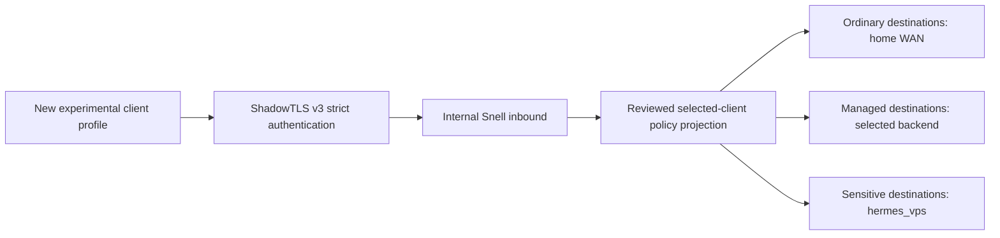

# Channel Snell lab

This additive home-first experiment uses stable sing-box 1.14.4, Snell v4
client semantics (the server calls the compatible implementation v5), and an
outer **ShadowTLS v3** transport in strict mode. Snell v6 is not selected:
its upstream protocol documentation still labels it beta. Three independent
listeners each have distinct Snell and ShadowTLS credentials. The inner Snell
inbounds have no listening socket; only the ShadowTLS listeners are public.



## Ownership and lifecycle

Runtime files live in `/opt/etc/ghostroute-snell`; logs, lock and watcher PID
live in `/tmp/ghostroute-snell`. The independent binary is `sing-box-snell`.
The controller `channel-snell.py` supports `start`, `stop` and `status` via
`/opt/bin/python3`. Do not run its internal `watch` action manually alongside
an existing watcher. A process lock prevents duplicate ownership.

The watcher uses the existing AnyTLS policy projector to derive policy directly
from the current main configuration. It does not depend on the running anyT
data-plane process. It checks every two seconds, validates changed configuration
before starting the child, and stops its child if projection/validation fails.
This polling boundary is not atomic policy propagation. Rule-set files retain
their existing sing-box ownership and reload behavior.

Firewall ownership is limited to `GR_SNELL_IN` and three TCP port-scoped INPUT
jumps. No Channel A/B/C/D/M or anyT chains, REDIRECT, OUTPUT, DNS settings or
client artifacts are changed. `stop` removes the owned jumps and accept rules.
The lab currently requires manual start after reboot; it is not a production
channel and has no production boot/cron contract. A running watcher repairs its
own rules after a firewall rebuild. Settings are immutable during an experiment;
stop and review before changing listener assignments.

## Policy and security

The projection retains router DNS enforcement, private/literal IPv6 rejection,
UDP/443 rejection, the managed split, and sensitive fail-closed routing. It
does not add automatic sensitive fallback. Client-side bypasses and hidden
hostnames remain outside this guarantee.

ShadowTLS is a separate authenticated camouflage layer, not a guarantee against
DPI. A forum success report on one network does not establish availability on
another. Snell's documented lack of forward secrecy and dedicated replay
protection must still be understood; use end-to-end HTTPS for application data.
Never use `unsafe-raw`, disable certificate verification, expose a naked Snell
listener, or replace a production anyT profile for this experiment.

## Private profiles and acceptance

Three private slots live under ignored `ansible/out/channel-snell/`. Each has
a matching sing-box JSON client and a Shadowrocket text profile. The JSON
transport chain is exercised by authenticated probes. The Shadowrocket text
import and preservation of its ShadowTLS fields require real-client acceptance;
do not treat a successful text import or a green TCP test as proof.

The private bundle also contains `Channel-Snell-01.png` through
`Channel-Snell-03.png`, matching `.uri` files and `qr-index.html`. Generate them
from the existing three identities without rotating settings:

```sh
python3 modules/routing-core/bin/channel-snell-profile ansible/out/channel-snell
```

The URI shape was obtained from Shadowrocket's own QR export of a manually
entered **fictional** Snell v4 / ShadowTLS v3 node. It encodes the inner Snell
identity as URL-safe Base64 and the `shadow-tls` query field as Base64 JSON with
version, cover name and outer password. No online QR/conversion service is used.
The exporter refuses a conflicting existing URI. Settings, text/JSON profiles,
server listeners and anyT imports are unchanged. Real QR/URI files remain ignored
credential material; do not commit or publish them.

Import using Shadowrocket **Home → Scan QR Code**, not the Config rule-file
import. Confirm the node reports **SNELL / SHADOW-TLS3** and retains Snell version
4, plugin version 3 and its cover name. Local PNG round-trip decoding verifies
the exact URI, not phone import or cellular connectivity. Those remain separate
acceptance steps; do not promote the lab merely because its QR scans.

Before accepting a phone profile, verify Snell v4 and ShadowTLS v3, cover name,
both passwords, and enabled certificate verification in the imported client.
Then compare the same phone/network against anyT: native application messages,
fresh media, HTTPS, video playback, reconnect, and bad-credential rejection.
The server probe covers authenticated application handshakes, ordinary and
sensitive HTTPS, YouTube HTML, wrong inner/outer credentials, and private/IPv6
rejection. HTML fetch does not establish video playback; router loopback probes
do not establish cellular reachability or censorship resistance.

## Upgrade and rollback

### Version boundaries

The separate lab binary is pinned to sing-box **1.14.4**. Its server-side Snell
implementation/version label must not be confused with the **v4 client profile**;
the outer transport is **ShadowTLS v3**, not REALITY. The three existing QR
payloads encode that combination and must retain both authentication layers.
Updating the main Entware binary does not automatically update `sing-box-snell`.

Snell changes the client-to-router hop. Managed and sensitive destinations still
use the policy-selected post-router backend. Therefore a backend compatibility
regression can affect a Snell client even when its ShadowTLS handshake succeeds.
The [software compatibility matrix](../../../docs/software-compatibility.md)
records the sensitive-egress core hold and the distinction between tested paths
and installed versions. A working anyT or router loopback probe is not cellular
acceptance of Snell. The lab remains manual-start after router reboot, with three
experimental profiles; it has not acquired anyT's production recovery contract.

Keep the proven Entware binary and configuration before updating any shared
runtime. A package upgrade can replace `/opt/etc/init.d/S99sing-box`; restore
the repo-managed rendered init script before relying on its `status`, zombie
handling and recovery contract. Validate the candidate against main and anyT
configurations before activation. Run `channel-anyt-check`, all eight private
identity probes, the platform active deploy gate, and channel-specific checks
after activation. Preserve old package metadata/packages as well as binaries
when a complete package downgrade is required; restoring one executable alone
does not roll back opkg's package database.

For lab rollback, stop the watcher and keep the private profiles/settings for
later review. Production routes and existing QR imports require no migration.

Local tests: `python3 tests/test-channel-snell-policy.py` and
`python3 tests/test-channel-snell-profile.py`. The profile tests compare a fake
native-export fixture and cover outer-password/SNI preservation, IPv6 syntax,
encoding and invalid-field rejection.

References: [Snell inbound](https://sing-box.sagernet.org/configuration/inbound/snell/),
[Snell outbound](https://sing-box.sagernet.org/configuration/outbound/snell/),
[ShadowTLS inbound](https://sing-box.sagernet.org/configuration/inbound/shadowtls/),
[ShadowTLS outbound](https://sing-box.sagernet.org/configuration/outbound/shadowtls/),
[Snell security and versions](https://kb.nssurge.com/surge-knowledge-base/release-notes/snell).
