# Cold emergency egress

The opt-in controller monitors `backup_reality` and can select the cold
`backup_reality_emergency` profile after thirty continuously observed minutes of
application failure. It samples every five minutes. A healthy sample, a sampling
gap, reboot or backwards clock resets the outage window. A stopped local proxy,
unavailable WAN or isolated application failure does not authorize switching.
Thirty minutes starts with the first failed sample. With five-minute sampling,
allow roughly thirty to thirty-five minutes plus probe and scheduler delays from
the actual outage.

Both profiles are router-only private Vault material. Never connect the two
profiles simultaneously, including diagnostics. The reserve is absent from the
production config until selected. A transition takes an exclusive OS lease shared
with init, watchdog, supervisor and channel recovery owners; stops main/anyT/Snell
and active Amn; proves the old engines are gone; qualifies the reserve using native
application requests, complete HTTPS canaries and an observed non-home exit; then
installs one profile and restarts the same enabled lanes. Channel M and all client
ingress identities remain unchanged. Disabled Amn stays disabled.
Qualification also checks application, login and unauthenticated API responses,
rejecting region-denial and browser-challenge bodies. An edge trace returning 200
does not establish application availability. Expected unauthenticated errors prove
transport, not successful login or a logged-in streaming session. Test the actual
client without a separate VPN before accepting the reserve for automatic use.

`reality-out` and any matching `sensitive-out`/D outbound move together only when
their complete profile matches the reviewed pair. Unknown manual configuration
is refused. There is no direct sensitive fallback. The reserve latches after a
successful switch: return is manual. Failed qualification stops its diagnostic
engine before restoring the previous profile. An interrupted transition blocks
ordinary recovery until the controller restores one complete configuration.

## Decision and state model

| Observation on the active path | Controller decision |
|---|---|
| All five native probes and all three HTTP checks fail; local proxy and direct WAN work | Continue the failure timer; attempt transition after thirty minutes |
| At least one external check succeeds | Reset timer; partial application failure does not switch the whole backend |
| Local listener or direct WAN unavailable | Reset timer; do not treat a local fault as backend failure |
| Reboot, backwards clock or sample gap over seven minutes | Reset timer; do not infer unobserved downtime |
| Emergency selected | Observe health; keep the latch; no automatic return |
| Stored profiles or qualification version changed | Require a new serial drill before enabling automatic decisions |
| Live profile no longer matches controller state | Disarm; preserve the operator's configuration |

```mermaid
stateDiagram-v2
    state "Normal profile active" as Normal
    state "Continuous outage window" as Timing
    state "Exclusive lease; stop owned engines" as Stop
    state "Only reserve diagnostic engine active" as Qualify
    state "Activate and verify reserve" as Activate
    state "Emergency active; manual return only" as Emergency
    state "Stop candidate; restore normal" as Restore
    [*] --> Normal
    Normal --> Timing: Complete external failure; local path healthy
    Timing --> Normal: Success, partial/local fault, reboot or sample gap
    Timing --> Stop: Thirty observed failed minutes
    Stop --> Qualify: Old engines confirmed stopped
    Qualify --> Activate: Application qualification passes
    Qualify --> Restore: Candidate rejected
    Activate --> Emergency: Postchecks and client preservation pass
    Activate --> Restore: Activation or postcheck fails
    Restore --> Normal: Previous normal profile restored
```



This diagram shows the automatic normal-to-emergency path. Manual return uses the
same stop/qualify/activate transaction with the roles reversed. A failed manual
return restores emergency. If rollback itself fails, the persistent transition
marker remains: recovery owners must not start an unknown profile. Recovery retries
the former configuration before ordinary service starts resume.

## Operator commands

```bash
./modules/routing-core/bin/emergency-egress install
./modules/routing-core/bin/emergency-egress drill
./modules/routing-core/bin/emergency-egress status
./modules/routing-core/bin/emergency-egress enable
./modules/routing-core/bin/emergency-egress disable
./modules/routing-core/bin/emergency-egress switch-normal
```

Install requires the existing `vault_router_backup_reality_*` fields and the
matching `vault_router_backup_reality_emergency_*` set. The latter accepts the
same TCP/gRPC Reality fields, including flow, ALPN and gRPC service name. Secrets
remain in Vault and mode-0600 router files. The installer saves a private recovery
copy of the current config and touched service scripts. It does not activate the
reserve or enable monitoring.

`drill` is an explicitly authorized service interruption, launched independently
of the management SSH connection. It qualifies emergency and normal serially and
returns to normal when both succeed. Inspect `drill-result.json` privately if the
command reports a failure. A profile-matched successful drill is required before
`enable`. Enabling registers the five-minute `EgressEmergency` cron; the runtime
supervisor recreates it at boot/recovery while the enabled marker
exists. `disable` preserves the selected route and disables automatic decisions.

Status reports selected backend, latch, outage age, transition state and last
application checks without endpoints or credentials. Full backend-bank authenticated
probes are refused while emergency is selected: use the controller's active-path
checks instead. Disarm before a router configuration deploy. An unexpected manual
profile change disarms the monitor rather than overriding the operator.

Automatic operation needs no Mac, Ansible or management VPS. Reboot preserves the
selected config and latch but discards the partial outage timer. All recovery
copies and detailed execution evidence belong in private operator storage.
Changing either stored profile invalidates qualification and disarms the monitor.
An older qualification version cannot enable the monitor after probe requirements
change. Re-run the authorized serial drill. Monitor polls wait briefly for recovery
leases; a busy long-running transition is skipped rather than overlapped.
If both paths fail, rollback restores the former local data plane without claiming
that its external egress is healthy. Provider recovery remains visible as an error.
Persistent configuration and transition records use synced atomic replacement.
Interrupted recovery also finds its exact private probe executable if a crash
occurred before its PID was recorded; unrelated diagnostics are left untouched.

## Manual return and incident recovery

1. Inspect `status`: selected backend, enabled flag, transition and last checks.
   Disabling monitoring preserves the selected route, including emergency.
2. Before router configuration deployment, use `disable` and wait for any active
   transition to finish. Keep a private recovery copy. Disarming preserves the
   recovery-owner lease and the one-profile rule.
3. Use `switch-normal` for an explicitly authorized return. It stops emergency,
   qualifies normal in isolation, restores enabled lanes and runs postchecks.
   Failure restores the previous profile; never start a second profile manually.
4. Check real client requests and media/streaming without a separate VPN, plus
   protected channel health. Unauthenticated probes cannot prove a logged-in session.
5. Re-enable monitoring only with a current successful serial drill. Check `status`
   again to confirm the selected backend and enabled flag.

`recover` resumes an interrupted transaction using the recorded previous profile;
it cannot bypass qualification. Raw evidence and service backups remain private.
Do not delete a transition marker to force startup.

## Checks

```bash
python3 tests/test-egress-emergency.py
bash tests/test-channel-anytls.sh
bash tests/test-channel-amn.sh
bash tests/test-runtime-supervisor-static.sh
bash tests/test-singbox-init-static.sh
```

Fixtures cover elapsed thresholds, resets, local/partial faults, transition
failure injection, interrupted recovery, failed rollback containment, unchanged
client/routing data, real shared/exclusive lease exclusion, and lock-descriptor
isolation from background daemons. Live serial qualification and real-client
acceptance remain separate from offline tests.
Local SOCKS/HTTP fixtures exercise actual curl requests and distinguish expected
authentication responses, region denials, edge challenges and missing response
bodies. They do not substitute for live application acceptance. If a client fails,
disarm automatic decisions, restore the qualified normal path and compare proxy,
LAN and real-client evidence separately; a VPN-bound interface failure alone does
not prove a router forwarding defect.
