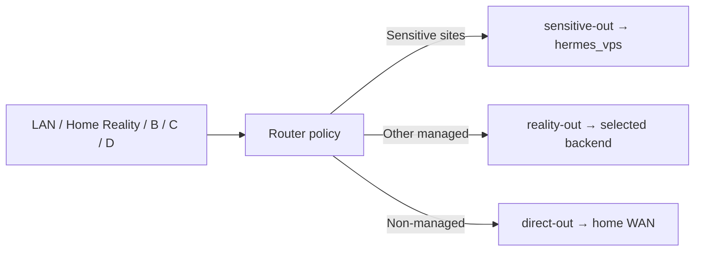

# Режим чувствительных сайтов / Sensitive sites mode

## Контракт

Это отдельная destination-policy внутри Routing Core, а не новый канал ingress.
При `vault_router_sensitive_sites_enabled: true` выбранные домены используют
`sensitive-out -> hermes_vps`, независимо от общего managed-backend и Channel D
pin. Остальные managed-направления сохраняют `reality-out` / `reality-out-d`.
Обычные non-managed направления сохраняют home-WAN direct.



Channel M исключён из sensitive rule и сохраняет свой home-WAN service egress.
Не меняются публичные ingress, credentials или QR/imported profiles клиентов.
Режим по умолчанию выключен; при выключении сохраняется прежняя политика.

## Каталог

Единственный список — [`configs/sensitive-domains.txt`](../../../configs/sensitive-domains.txt).
Запись покрывает сам домен и его поддомены. Каталог содержит:

| Группа | Назначение |
|---|---|
| Claude / Anthropic | Web, API, OAuth/SSO, Desktop, user-content, artifacts и MCP widgets |
| OpenAI / ChatGPT | Web/app, API, auth, WebSockets, static/user-content и feature configuration |
| Google AI | Gemini, AI Studio / Gemini API, NotebookLM |
| Shared auth | Выбранные Google OAuth, WorkOS и challenge endpoints |

Не добавляйте целиком `google.com`, `googleapis.com`, `gstatic.com` или
`googleusercontent.com`: это переведёт посторонние Google-сервисы в этот режим.
Search и YouTube сохраняют обычный managed путь. Общий `accounts.google.com`
использует sensitive egress также при входе в другие Google-сервисы: роутер
видит destination hostname, а не страницу, которая инициировала запрос.

Каталог — целевой набор сервисов и auth-зависимостей, а не полный allowlist
всех сторонних ресурсов страницы. Общие CDN, fonts, billing, support, telemetry,
package registries и сайты, открываемые AI по ссылкам, не переводятся целиком.
Они сохраняют действующую managed/direct политику. В частности, Claude Code
может скачивать пакеты с GitHub/npm через общий managed egress.

Все sensitive-семейства должны одновременно покрываться
`configs/dnsmasq-stealth.conf.add`, иначе LAN-запрос может не попасть в REDIRECT.
Пересечение с `configs/domains-no-vpn.txt` запрещено тестом. Автоматическое
domain discovery расширяет только managed-каталог и не включает новые
направления в sensitive mode без operator review.

## Приоритет и границы гарантии

Для применимых inbounds выполняется HTTP/TLS sniff перед любым общим catch-all;
затем domain suffix rule выбирает `sensitive-out`. Это важно для LAN REDIRECT:
исходное соединение может содержать только IP, и без sniff оно попало бы в
общий managed путь. Явное имя назначения SOCKS/CONNECT также подходит.

`sensitive-out` — один VLESS Reality/Vision outbound с owned identity, без
selector, urltest, балансировки и direct fallback. Ошибка соединения по
**совпавшему правилу** остаётся ошибкой: она не должна менять внешний IP через
другой backend. Это не гарантия, что провайдер никогда не переназначит IP VPS.

Domain routing требует видимого hostname (SOCKS/CONNECT, HTTP Host или TLS SNI).
ECH, raw-IP, неподконтрольный DoH, отдельный VPN/Private Relay и обход домашнего
роутера могут скрыть классификацию. Для такого трафика стабильность identity
не доказана; не называйте это универсальным kill switch. Не добавляйте общие
CDN IP/CIDR как исправление: они затронут несвязанные сайты. Старые сессии,
профиль аккаунта и геополитика сервиса также не переписываются маршрутом.

DNS ownership остаётся у текущих dnsmasq/dnscrypt и managed DNS policy. DNS
запрос к общему resolver не считается обращением к sensitive web/API и не
переносится целиком на другой backend.

## Применение и откат

1. Проверить owned backend, endpoint и Reality identity в Vault. Записать
   прежний общий backend и состояние sensitive mode в gitignored operator note.
2. В Vault включить `vault_router_sensitive_sites_enabled: true`, сохранив
   прежний `vault_router_managed_egress_mode`. При согласованном выключении
   режима вернуть boolean в `false`: sensitive-направления снова станут обычными
   managed, поэтому такой откат явно меняет их identity policy.
3. Запустить локальные проверки и syntax-check ниже. Применять существующий
   `20-stealth-router.yml` только с operator authorization и штатными deploy
   gates. Не менять IP VPS или client profiles ради включения этого режима.
4. После применения проверить runtime `sensitive-out`, порядок правил, каталоги,
   app-canaries и отдельный фактический egress. Обычный `api.ipify.org` проверяет
   **общий** managed путь, а не sensitive egress. HTTP 403 от curl к Claude
   доказывает reachability, но не успешную авторизованную сессию.
5. Проверить app/login на реальном клиенте. При неуспехе восстановить прежнюю
   конфигурацию; не подменять sensitive egress незаметным fallback.

```bash
bash tests/test-sensitive-sites.sh
bash modules/ghostroute-health-monitor/tests/test-egress-backend-health.sh
cd ansible
ansible-playbook --syntax-check playbooks/20-stealth-router.yml
```

`egress-backend-health --json` добавляет `sensitive_sites_backend` и
`app_canaries[].expected_backend`. Это attribution по конфигурации, а не
измерение внешнего IP. Успешный Claude/OpenAI canary нельзя приписывать общему
backend. Не публикуйте endpoint, UUID, ключи или actual-egress evidence.

## Ревью и расширение

Reviewed: 2026-10-31. Дополнительно к прежнему каталогу проверены
`claudeusercontent.com` (artifacts/extension bridge), `claudemcpcontent.com`
(MCP widgets), NotebookLM product domain и выбранные WorkOS/challenge
auth-зависимости. Gemini Live WebSockets входят в
`generativelanguage.googleapis.com`; ChatGPT WebSockets — в `chatgpt.com`.

Источники: [OpenAI network recommendations](https://help.openai.com/en/articles/9247338-network-recommendations-for-chatgpt-errors-on-web-and-apps),
[Claude network requirements](https://code.claude.com/docs/en/network-config),
[Gemini API](https://ai.google.dev/api).
Google shared dependencies не имеют отдельного полного AI-only allowlist в
проверенных источниках: новые backend-хосты требуют runtime evidence и review.

Для нового сайта сначала подтвердить provider-owned/auth domains, добавить
узкие suffix entries в оба каталога, проверить отсутствие direct-конфликтов,
добавить positive/negative routing fixtures и app canary. Общие CDN расширять
только с явным пониманием влияния на другие сайты. Тесты проверяют precedence,
A/B/C/D и selected full-VPS parity, Channel M isolation, legacy disabled mode,
spoofed suffixes, Google scope и отсутствие automatic fallback.

Наблюдаемость сохраняет outbound tag: `sensitive-out` считается `VPS` в
route-evidence и `traffic-facts` v3, а live events получают `SENSITIVE_SITES`.
Регрессии также проверяют сохранение этой метки в Console и отсутствие
ошибочного учёта sensitive-трафика как home-WAN direct.
