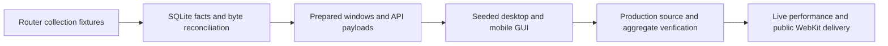

# Tests

The test layer covers safe parser/renderer/reporting behavior. It does not emulate the ASUS/Merlin runtime.

## Current Runtime Contract

Docs and health tests should assume the current production policy:

```text
br0 TCP     -> STEALTH_DOMAINS / VPN_STATIC_NETS -> nat REDIRECT :<lan-redirect-port> -> sing-box -> Reality
br0 UDP/443 -> STEALTH_DOMAINS / VPN_STATIC_NETS -> DROP, forcing TCP fallback
OUTPUT      -> main routing by default; explicit proxy only for router-local diagnostics
wgs1        -> VPN_DOMAINS / VPN_STATIC_NETS    -> 0x1000 -> table wgc1
```

Legacy expectations such as `br0 -> RC_VPN_ROUTE`, `OUTPUT -> RC_VPN_ROUTE`, or per-domain `@wgc1` DNS upstreams are not the normal state anymore.

## What Tests Cover

### Traffic layer gates

| Gate | Command | Defects caught |
|---|---|---|
| Collection | `./tests/run-traffic.sh --collection` | Router cadence/read-only boundary, DNS cursor replay/rotation/incomplete lines, source timestamps and source JSON/counter contracts |
| Data | `./tests/run-traffic.sh --data` | SQLite normalization, volume/detail ownership, midnight windows, channel/client reconciliation and prepared destination/application rankings |
| GUI/API | `./tests/run-traffic.sh --gui` | Seeded desktop/mobile/iPhone rendering, API-to-card parity, filters and selected-client DNS/application separation |

Run the smallest relevant layer first; `./tests/run-traffic.sh --all` executes
them in that order and stops at the first failed layer. The collection gate is
part of `run-fast.sh`; the data gate is used by `run-console.sh --fast`; the GUI
gate is used by `run-console.sh --smoke`. Existing CI entrypoints therefore retain
coverage with explicit layer labels. Production source freshness and browser
delivery/performance still require the separate post-deployment gates.

The overnight data fixture deliberately combines gigabyte counters with smaller
measured domain/provider rows. It asserts preserved detail and exact totals, without
requiring partial application evidence to equal all bytes. GUI tests compare actual
prepared API rankings with visible cards. Passing one layer cannot stand in for another.

#### Acceptance order and failure ownership



| Layer | Evidence required before proceeding | Where to fix a failure |
|---|---|---|
| 1. Collection | Read-only routing boundary; successful sampler status; original event timestamps; no DNS replay after polling/rotation; new records append without rewriting quiet history; hourly/safety-ceiling compaction preserves the retained records | Router reader, cursor, cadence or bounded storage helper. A load/lock skip is partial coverage, not a successful zero-byte sample |
| 2. Facts and storage | Exact counter bytes and stable client/channel identities; no overlap/double counting; correct midnight windows; volume, destination detail and DNS interest remain separate | Normalization, fact ownership or SQLite aggregation. Never scale sparse app/DNS observations to fill a counter gap |
| 3. Prepared/API | Prepared destination/app rankings preserve measured domain/provider evidence; sums and residuals reconcile within their own scope; repeated imports do not duplicate bytes; cache invalidation notices external commits, local writes and DDL | Prepared-window builder, API selector or cache versioning. An empty ranking with existing eligible detail is a data failure |
| 4. GUI | Local seeded database and production build; API/card parity; filters, selection and pagination; distinct byte/DNS displays; applied mobile CSS and reachable controls on desktop/mobile/iPhone | Rendering, filtering or delivery. A screenshot cannot establish collection correctness |
| 5. Production data | A completed real full collection; expected sources present without blocking errors; `verify:post-deploy`, `verify:aggregates` and `verify:timezone` pass against the deployed data | Deployed reader/access gate, ingestion or aggregation. Retain private diagnostics and resolve this before interpreting browser results |
| 6. Production browser/performance | Live response budgets; public no-port HTTPS in Chromium and iPhone/WebKit; mobile first paint, Live summary and inline traffic detail work | Query/render/delivery path. Keep timing failures distinct from missing data or attribution gaps |

Layers 2 and 3 run together under `--data`; API-to-card assertions also run under
`--gui`. Layers 5 and 6 are explicit live checks, not part of a fixture run.
Ranking screenshots capture the checked cards rather than an unbounded full page,
so high-density iPhone/WebKit captures do not exceed browser image-size limits.
Run the module npm verification commands from the app directory with the intended
database selected; seeded verification must never be mistaken for production evidence.
Live browser/performance setup and commands belong to the
[Console runbook](../modules/ghostroute-console/README.md).

Start production acceptance after the initial full collection has completed.
Keep failed timing evidence from startup/ingestion contention, then repeat after
that known overlap has ended; do not disable normal collectors, relax budgets or
reuse an earlier release's green result to obtain acceptance.

For a bug fix, add a reproducing case at the earliest failing layer and then verify
the downstream layers affected by the change. In particular, a collection fix needs
source fixtures and data reconciliation before GUI review. A cache/performance fix
must preserve visibility of newly committed data, not merely serve stale cached rows.

### Fast checks

```bash
./tests/run-fast.sh
```

This is the default local and CI gate. It runs shell syntax checks, the
repo secret scan, fixture/static tests, Console JSON contracts, Console unit
tests, and a production build. It does not run Playwright.

Console checks are connected through the root bridge:

```bash
./tests/run-console.sh --fast
```

The bridge keeps the root test layer as the orchestrator while
`modules/ghostroute-console/app` remains the owner of npm scripts, Playwright
configuration, seeded GUI data and Console fixtures.

### Console smoke

```bash
./tests/run-smoke.sh
```

This compatibility entrypoint runs the seeded GUI gate, including the production
build and desktop/mobile/iPhone browser coverage. Its historical `smoke` name does
not mean that only the first screen is checked.

Equivalent explicit bridge command:

```bash
./tests/run-console.sh --smoke
```

### Performance checks

```bash
./tests/run-performance.sh
```

This runs Console performance budget checks through
`./tests/run-console.sh --perf`. Performance assertions live only in the
Console performance suite; they are not part of default `run-all.sh`, because
timing budgets are useful diagnostics but less deterministic than functional
checks.

### Compatibility wrapper

```bash
./tests/run-all.sh
./tests/run-all.sh --full
```

`run-all.sh` runs fast checks plus Console smoke by default. `--full` runs the
full Playwright e2e suite after fast checks against the seeded GUI database and
the standalone production build.

For the complete module-owned Console local gate, use:

```bash
./tests/run-console.sh --all
```

### Fixture tests

```bash
./modules/recovery-verification/tests/test-router-health.sh
./modules/dns-catalog-intelligence/tests/test-catalog-review.sh
./modules/dns-catalog-intelligence/tests/test-dns-forensics.sh
./modules/ghostroute-health-monitor/tests/test-health-monitor.sh
./modules/ghostroute-health-monitor/tests/test-vps-health-monitor.sh
./tests/test-module-entrypoints.sh
```

These tests validate:

- stable parsing of saved health/journal/report text
- stable Markdown rendering for humans and LLMs
- catalog review output shape
- DNS forensics snapshot/report formatting
- health monitor JSONL/status aggregation, local alert ledger, summary rendering
- VPS observer fixtures and merged GhostRoute health report rendering
- module-native entrypoints and reserved `scripts/` policy
- A/B/C managed-split parity: all home-first mobile channels must apply the
  same post-router `STEALTH_DOMAINS` / `VPN_STATIC_NETS` policy as Wi-Fi/LAN.
  `api.ipify.org` is only the pinned canary for that broader invariant.
- Managed domain policy sources: manual catalog, private/local catalog hook,
  auto-discovered domains, static CIDRs, Russian-TLD skip rules, and
  `domains-no-vpn.txt` exclusions.

They do not connect to the router.

### Syntax checks

```bash
bash -n verify.sh tests/check-shell-syntax.sh tests/run-console.sh tests/run-fast.sh tests/run-smoke.sh tests/run-performance.sh tests/run-all.sh tests/test-module-entrypoints.sh
bash -n modules/recovery-verification/bin/verify.sh modules/ghostroute-health-monitor/bin/router-health-report modules/traffic-observatory/bin/traffic-report modules/traffic-observatory/bin/traffic-daily-report modules/traffic-observatory/bin/traffic-summary modules/shared/lib/router-health-common.sh modules/recovery-verification/tests/test-router-health.sh
bash -n modules/dns-catalog-intelligence/bin/catalog-review-report modules/dns-catalog-intelligence/bin/dns-forensics-report modules/dns-catalog-intelligence/tests/test-catalog-review.sh modules/dns-catalog-intelligence/tests/test-dns-forensics.sh modules/secrets-management/bin/cleanup-vault-backups
sh -n modules/routing-core/router/firewall-start modules/routing-core/router/nat-start modules/dns-catalog-intelligence/router/domain-auto-add.sh modules/ghostroute-health-monitor/router/lib.sh modules/ghostroute-health-monitor/router/run-probes modules/ghostroute-health-monitor/router/aggregate modules/ghostroute-health-monitor/router/daily-digest modules/ghostroute-health-monitor/router/run-once modules/ghostroute-health-monitor/vps/lib.sh modules/ghostroute-health-monitor/vps/run-probes modules/ghostroute-health-monitor/tests/test-health-monitor.sh
bash -n modules/ghostroute-health-monitor/bin/ghostroute-health-report modules/ghostroute-health-monitor/tests/test-vps-health-monitor.sh
```

### Ansible syntax

```bash
cd ansible
ansible-playbook --syntax-check playbooks/20-stealth-router.yml
ansible-playbook --syntax-check playbooks/21-channel-b-router.yml
ansible-playbook --syntax-check playbooks/22-channel-c-router.yml
ansible-playbook --syntax-check playbooks/10-stealth-vps.yml
ansible-playbook --syntax-check playbooks/11-channel-b-vps.yml
ansible-playbook --syntax-check playbooks/30-generate-client-profiles.yml
ansible-playbook --syntax-check playbooks/99-verify.yml
```

### Live smoke

Live smoke reads the router/VPS and may require network access:

```bash
./verify.sh
./modules/ghostroute-health-monitor/bin/router-health-report
./modules/traffic-observatory/bin/traffic-report
cd ansible && ansible-playbook playbooks/99-verify.yml
```

Expected health semantics:

- `STEALTH_DOMAINS` exists.
- sing-box REDIRECT listener on `:<lan-redirect-port>` exists.
- LAN TCP REDIRECT rules exist for `STEALTH_DOMAINS` and `VPN_STATIC_NETS`.
- LAN UDP/443 DROP rules exist for `STEALTH_DOMAINS` and `VPN_STATIC_NETS`.
- `api.ipify.org` is pinned through `ipify.org` and mirrored into the sing-box
  `stealth-domains` rule-set, so LAN/Wi-Fi and Channels A/B/C classify it the
  same way. This checker does not replace the general rule: all managed
  catalog domains/static CIDRs must follow the shared managed split after the
  traffic reaches the router.
- Manual `STEALTH_DOMAINS`, auto-discovered `STEALTH_DOMAINS`, live
  `STEALTH_DOMAINS` IP snapshots, and `VPN_STATIC_NETS` static CIDRs are all
  mirrored into the mobile sing-box source rule-sets.
- Russian TLDs and `domains-no-vpn.txt` entries are not auto-added to managed
  domains.
- legacy `fwmark 0x2000`, table `200`, and `singbox0` are absent.
- `br0 -> RC_VPN_ROUTE` is disabled.
- `OUTPUT -> RC_VPN_ROUTE` is disabled.
- `wgs1 -> RC_VPN_ROUTE` is enabled.
- `wgs1 -> STEALTH_DOMAINS` is disabled.

## What Tests Do Not Cover

- Real packet forwarding correctness.
- Real Caddy/Xray handshakes.
- Actual client QR usability.
- Live secrets/vault values.
- Provider-side blocking behavior.

Use `ansible/playbooks/99-verify.yml` plus manual client checks for those.

## Documentation Consistency Check

After documentation updates:

```bash
rg '@wgc1|OUTPUT -j RC_VPN_ROUTE|PREROUTING -i br0 -j RC_VPN_ROUTE|server=/.*@wgc1' README*.md docs CLAUDE.md
```

Remaining matches must be explicitly marked as legacy, retired, rollback-only, or historical.
